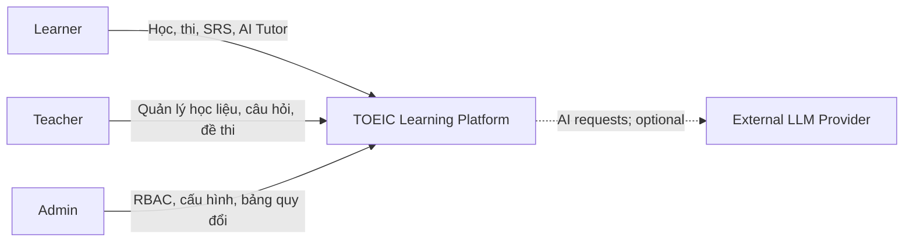
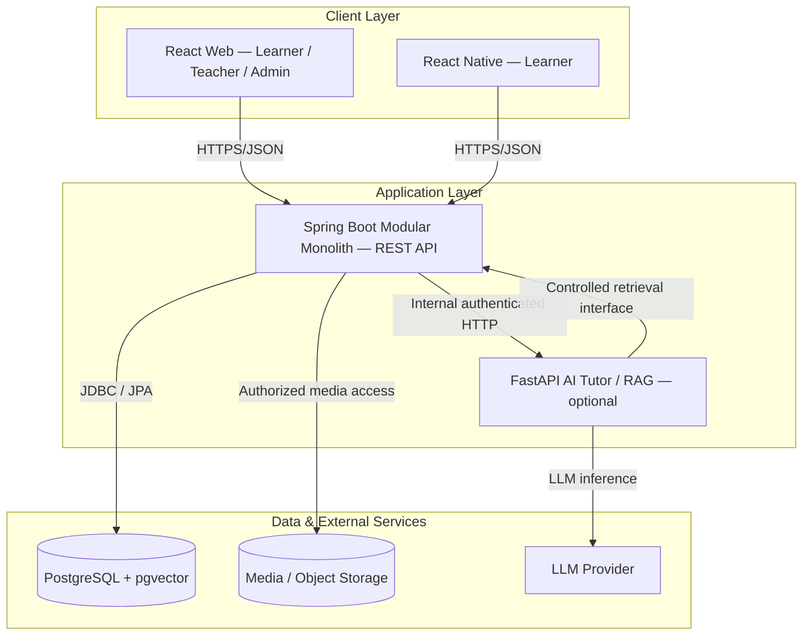
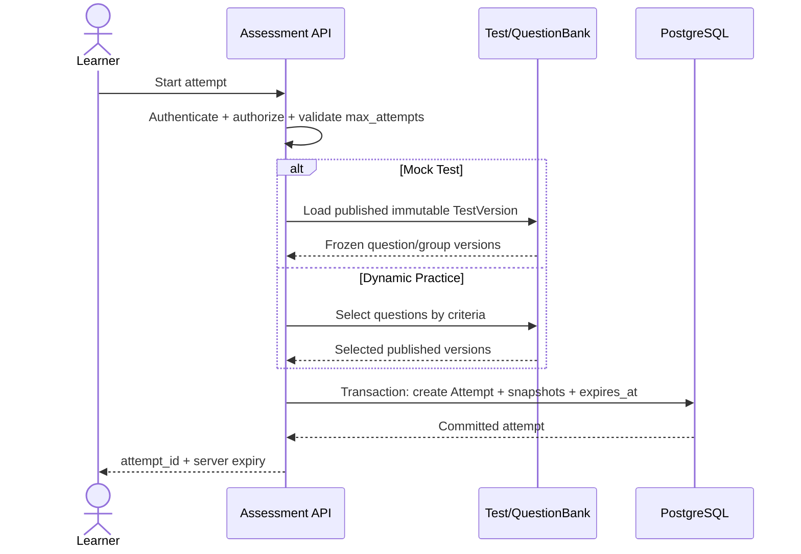
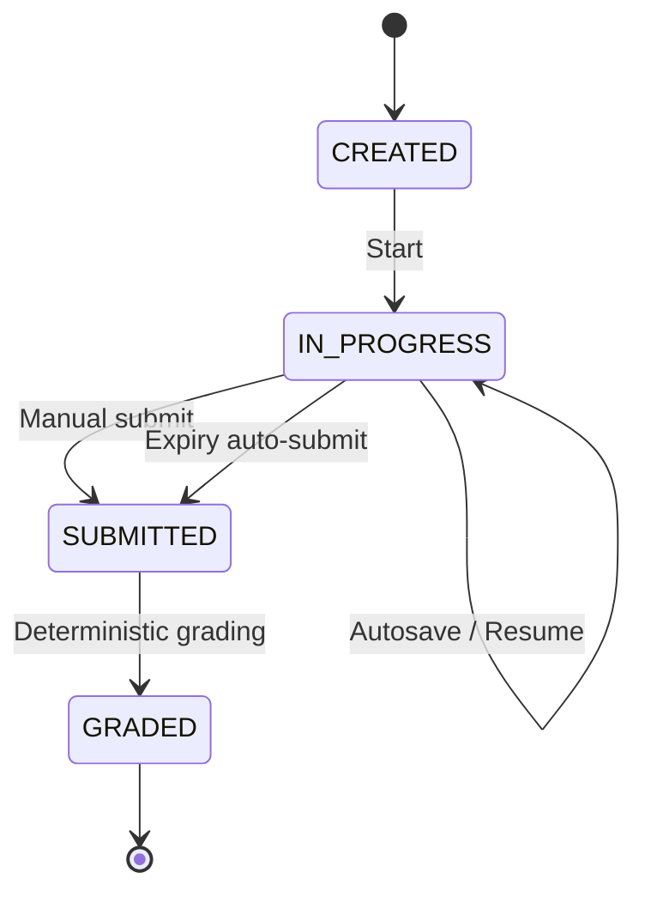
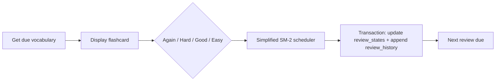
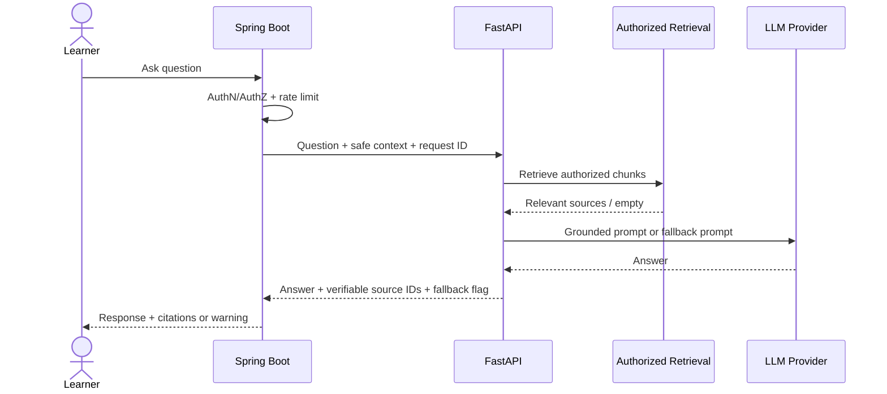
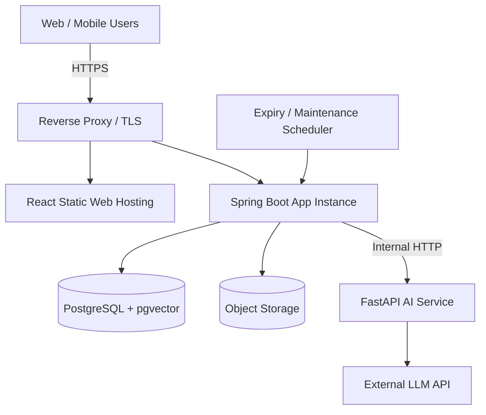
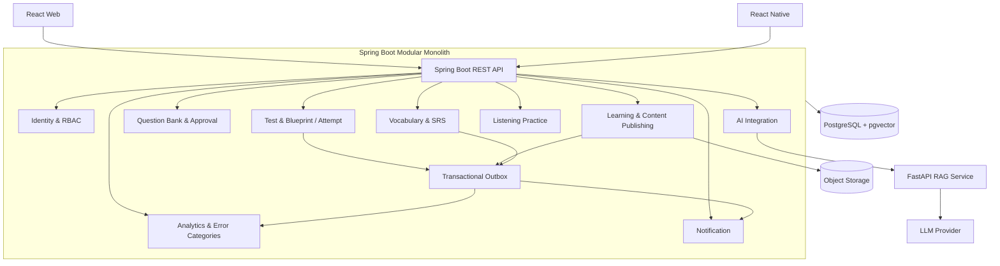
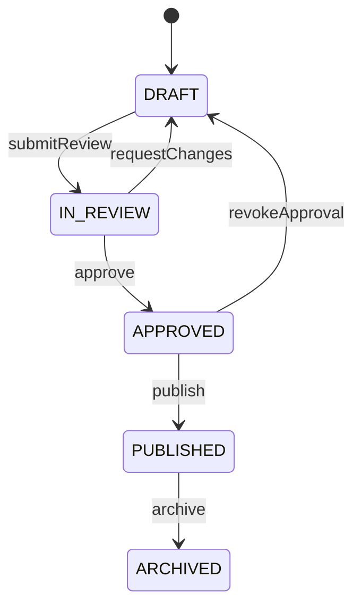

# SOFTWARE ARCHITECTURE DOCUMENT (SAD / HLD v1.0)

> **SYNC REVIEW v1.7 — 2026-10-28 | Trạng thái: đồng bộ tài liệu, CHƯA freeze/validate runtime**
> **Đồng bộ:** Phần B (HLD v1.1) có ưu tiên khi xung đột với Phần A (v1.0). Tên module code chuẩn hóa theo LLD là `content` (thay cho `learning` ở các đoạn HLD cũ); `notification` là module riêng. Chuẩn lỗi API là `code`, `message`, `traceId`, `details` (thay cho `requestId`/`timestamp` trong đề xuất cũ). Baseline dữ liệu tham chiếu hiện tại là ERD v1.6, không còn v1.2/v1.3. Chưa có bằng chứng migration chạy thành công.
> Tài liệu liên quan: [SRS](SRS.md) · [HLD](HLD.md) · [LLD](LLD.md) · [API](API_Specification.md) · [ERD v1.6](ERD_v1.6.md).


**Dự án:** TOEIC Learning Platform  
**Trạng thái:** Proposed architecture — chờ architecture review  
**Cơ sở:** SRS v1.1, ERD v1.2 Reviewed (52 bảng), các quyết định nghiệp vụ đã thống nhất.  
**Phạm vi:** High-Level Design; không thay thế LLD, API Specification hay PostgreSQL migration.

---

## 1. Executive Summary

Hệ thống cung cấp học liệu TOEIC, luyện tập theo Part, Section Test, Full Mock Test, Dictation, Shadowing, từ vựng với Spaced Repetition System (SRS), theo dõi tiến độ và AI Tutor dựa trên Retrieval-Augmented Generation (RAG).

**Kiến trúc lựa chọn:** **Spring Boot Modular Monolith** cho nghiệp vụ cốt lõi, **React Web** (Learner/Teacher/Admin), **React Native** (Learner Mobile), **PostgreSQL + pgvector** cho dữ liệu, **FastAPI AI Service** tùy chọn, cùng kho lưu trữ media (object storage hoặc tương đương).

**Nguyên tắc trọng tâm:**

1. Spring Boot là **source of truth** của tài khoản, học liệu, câu hỏi, bài thi, chấm điểm, SRS và quyền truy cập.
2. Bài thi và lịch sử kết quả phải tham chiếu **phiên bản nội dung bất biến**.
3. AI Tutor có thể ngừng hoạt động mà **không làm gián đoạn** học tập, thi thử và SRS.
4. Phân tách module theo domain; tránh circular dependencies và chia sẻ repository tùy tiện.
5. Đơn giản hóa triển khai MVP; không tách microservices cho từng domain.

## 2. Phạm vi và các giả định

### 2.1 In scope

- Learner Web/Mobile; Teacher/Admin Web.
- Authentication, Authorization, Content, Question Bank, Assessment, Vocabulary/SRS, Learning Analytics, Dictation/Shadowing, AI Tutor/RAG, Audit/Settings.
- REST API, persistence, media, logging, security, testability và triển khai MVP.

### 2.2 Out of scope ở HLD này

- Thiết kế UI chi tiết; từng endpoint/DTO; class diagram toàn bộ entity; SQL migrations hoàn chỉnh.
- Hạ tầng cloud/vendor cụ thể, thanh toán, microservices orchestration, AI fine-tuning.
- Công bố điểm TOEIC chính thức từ ETS; hệ thống chỉ cung cấp **estimated score** theo bảng quy đổi được quản lý.

### 2.3 Quyết định chưa khóa

- Hosting, object storage provider, LLM/embedding model và kích thước embedding (ERD đang ghi `vector(768)` tạm thời).
- Chiến lược refresh token, chính sách lưu recording, quy mô tải và các SLO chính thức.
- Phê duyệt cuối cùng DBML v1.2 sau khi import và kiểm chứng PostgreSQL constraints.

## 3. Architecture Drivers

### 3.1 Functional drivers

| ID | Nhu cầu | Hệ quả kiến trúc |
|---|---|---|
| FD-01 | Mock Test / Section Test | TestVersion bất biến, attempt lifecycle, server-side timer |
| FD-02 | Dynamic Practice | Immutable AttemptQuestionSnapshot, không bắt buộc TestVersion |
| FD-03 | Chấm điểm | Deterministic grading, bảng quy đổi phiên bản, idempotent submit |
| FD-04 | SRS | ReviewState theo `(user_id, vocabulary_id)` và ReviewHistory append-only |
| FD-05 | Dictation / Shadowing | Media/recording pipeline; tách scoring logic phù hợp từng loại |
| FD-06 | AI Tutor | Authorized retrieval, citation provenance, fallback minh bạch |
| FD-07 | Teacher/Admin | Content versioning, RBAC, audit trail |

### 3.2 Quality attributes

| Attribute | Yêu cầu thiết kế | Cách đánh giá |
|---|---|---|
| Security | HTTPS, RBAC, least privilege, không lộ dữ liệu người dùng | AuthZ tests, threat review |
| Data integrity | Attempt, answers, content versions, scoring nhất quán | FK/CHECK/transaction tests |
| Reliability | Resume attempt, expiry auto-submit, submit idempotent | Integration & concurrency tests |
| Availability | Core features hoạt động khi AI service lỗi | Fault injection |
| Maintainability | Module boundaries, interface rõ, test độc lập | Dependency tests, code review |
| Performance | Mục tiêu thử nghiệm ban đầu p95 API thường < 500 ms trong tải được định nghĩa | Load test; chưa phải cam kết SLO |
| Observability | Structured logs, correlation ID, health checks | Operational verification |
| Privacy | Hạn chế PII trong logs/prompts; bảo vệ recordings | Data flow review |

## 4. C4 Level 1 — System Context



**Trust boundary:** Người dùng và external LLM nằm ngoài backend tin cậy. Mọi yêu cầu phải được xác thực/phân quyền tại Spring Boot. Nội dung retrieval cho AI phải được lọc theo quyền truy cập.

## 5. C4 Level 2 — Container Architecture



> **Lưu ý:** Đường AI → API biểu diễn interface truy xuất tài liệu đã được cấp quyền; cần tránh AI Service truy vấn trực tiếp toàn bộ bảng nghiệp vụ. Nếu lựa chọn AI đọc pgvector trực tiếp, phải có database role chỉ đọc và kiểm soát quyền theo user/context; đây là phương án thay thế cần ADR riêng.

### 5.1 Container responsibilities

| Container | Trách nhiệm | Không chịu trách nhiệm |
|---|---|---|
| React Web | UX học viên, giáo viên, admin; form validation | Chấm điểm authoritative |
| React Native | UX học viên trên mobile | Business rules authoritative |
| Spring Boot | Authentication, authorization, content, assessment, SRS, analytics, audit | Sinh câu trả lời LLM |
| PostgreSQL | Transactional data, constraints, versioned records, vector embeddings | Xử lý request HTTP |
| FastAPI | Retrieval orchestration, prompt building, model invocation | Sửa điểm thi, ghi review state |
| Media Storage | Lưu và phân phối audio/images/recordings theo quyền | Quản lý quyền nghiệp vụ độc lập |
| LLM Provider | Inference | Quyết định điểm thi hay quyền truy cập |

## 6. C4 Level 3 — Spring Boot Components

### 6.1 Module map

| Module | Core responsibilities | Dữ liệu tiêu biểu trong ERD |
|---|---|---|
| `identity` | Users, roles, permissions, authentication | `users`, `roles`, `permissions`, `user_roles`, `role_permissions` |
| `learning` | Categories, content, resources, bookmarks, progress | `learning_contents`, `media_resources`, `learning_progress` |
| `questionbank` | Questions, choices, groups, immutable versions | `questions`, `question_versions`, `question_group_versions`, `question_choices` |
| `assessment` | Tests, test versions, attempts, snapshots, grading, score conversion | `test_versions`, `test_questions`, `attempts`, `attempt_question_snapshots`, `score_conversion_*` |
| `vocabulary` | Decks, vocabulary, simplified SM-2, review history | `vocabularies`, `vocabulary_decks`, `review_states`, `review_history` |
| `analytics` | Learning profiles, Part performance, recommendations | `learning_profiles`, `part_performance`, `recommendations` |
| `listening` | Dictation, shadowing, attempts, feedback | `dictation_*`, `shadowing_*` |
| `ai` | Conversation metadata, source references, AI adapter | `ai_conversations`, `ai_messages`, `knowledge_*`, `ai_message_sources` |
| `system` | Settings, audit, cross-cutting operational functions | `system_settings`, `audit_logs` |

> ERD có **8 nhóm domain** theo cách gom ở bản thiết kế dữ liệu; code có thể tách `vocabulary` và `analytics` thành hai module để tăng cohesion. **Số module code không nhất thiết bằng số domain ERD.**

### 6.2 Module dependency rules

- `assessment` dùng **published question version contract** từ `questionbank`, không chỉnh sửa version đã xuất bản.
- `analytics` tiêu thụ kết quả đã chấm và sự kiện học tập; không trực tiếp sửa `attempts`.
- `vocabulary` sở hữu review state/history; UI và analytics không tự tính lại lịch SRS.
- `ai` dùng public interfaces để truy xuất nội dung được cấp quyền; không được sửa grading.
- `system` chứa audit/settings; không biến thành “god module” cho business logic.
- `shared` chỉ chứa cross-cutting utilities thật sự dùng chung; tránh đặt business services tại đây.
- Không để module A phụ thuộc B đồng thời B phụ thuộc A; dùng interface hoặc domain event nếu cần.

### 6.3 Recommended internal layering

```text
backend/src/main/java/com/toeic/platform/
├── identity/
│   ├── api/                 # REST controller, request/response DTO
│   ├── application/         # Use cases, orchestration, transaction boundaries
│   ├── domain/              # Business rules, domain models
│   └── infrastructure/      # JPA adapters, external integrations
├── learning/
├── questionbank/
├── assessment/
├── vocabulary/
├── analytics/
├── listening/
├── ai/
├── system/
└── shared/
    ├── security/
    ├── exception/
    └── config/
```

**Transactions:** application service quản lý transaction; repository chỉ được gọi qua ownership boundaries hoặc public module contract. Có thể dùng Spring Modulith để kiểm tra module dependencies, nhưng không bắt buộc trong MVP.

## 7. Critical Runtime Scenarios

### 7.1 Start attempt: Mock Test vs Dynamic Practice



**Invariants:**

- `source_type = TEST_VERSION` ⇒ `test_version_id IS NOT NULL`.
- `source_type = PRACTICE_SNAPSHOT` ⇒ `test_version_id IS NULL`.
- **Cả hai loại attempt** phải có `AttemptQuestionSnapshot` tạo atomically lúc bắt đầu.
- `max_attempts = NULL` nghĩa là không giới hạn; nếu giới hạn phải enforce bằng transaction/locking chống race condition.
- `expires_at` được tính và lưu bởi server.

### 7.2 Autosave, submit, expiry, grading



- Browser đóng: attempt giữ `IN_PROGRESS`; learner có thể resume khi chưa hết hạn.
- Server kiểm tra expiry tại mọi thao tác và có thể có scheduled expiry worker.
- Manual submit và auto-submit cạnh tranh phải chỉ có **một chuyển trạng thái thắng**; dùng conditional update/row locking và transaction.
- Chấm điểm từ **snapshot + frozen answer key**, không từ nội dung đang được chỉnh sửa.
- Retry submit trả cùng kết quả/trạng thái, không cộng điểm hoặc chấm lại nhiều lần.
- Trạng thái `SUBMITTED` có thể tồn tại tạm thời khi grading chưa hoàn tất; cơ chế retry phải idempotent.

### 7.3 TOEIC score conversion

- Lưu Listening/Reading raw correct counts.
- Estimated score chỉ được tính khi có **bảng quy đổi active, hợp lệ** và phù hợp bài thi.
- Ghi `score_conversion_table_id` vào Attempt để truy vết phiên bản.
- Nếu không có bảng hợp lệ: hiển thị **raw correct counts**, để estimated scores là `NULL`.
- Quy tắc đã được dùng để chấm lịch sử phải bất biến; bản cập nhật tạo version mới.
- Estimated score **không phải điểm ETS chính thức**.

### 7.4 Vocabulary SRS



- MVP: 1 Vocabulary = 1 Flashcard; state unique theo `(user_id, vocabulary_id)`.
- History append-only, mỗi review ghi rating, thời điểm và kết quả scheduling.
- Review scheduling nằm ở backend, không để web/mobile tự quyết định interval.
- Cần chốt công thức Again/Hard/Good/Easy và timezone trước LLD.

### 7.5 AI Tutor / RAG



- Chỉ trích dẫn tài liệu thực sự truy xuất và có thể xác minh.
- Nếu không có nguồn đáng tin cậy, có thể trả lời từ kiến thức mô hình nhưng phải hiển thị **“Không tìm thấy tài liệu tham khảo trong hệ thống.”**
- Không giả mạo citation; không công bố AI grading như điểm thi chính thức.
- Lỗi FastAPI/LLM: trả lỗi AI có kiểm soát; core learning/testing/SRS vẫn chạy.
- Bảo vệ PII, giới hạn prompt/context, timeout, retry có giới hạn, rate limiting.

### 7.6 Dictation / Shadowing

- `listening` quản lý exercise, audio reference, attempt và feedback.
- Recording lưu ở media storage; DB lưu metadata/URI/ownership.
- Upload phải kiểm tra file type, kích thước, ownership, retention và signed access.
- Shadowing feedback có thể sử dụng thuật toán/AI riêng; không làm hỏng workflow nếu thành phần feedback nâng cao lỗi.

## 8. Data Architecture & Consistency

### 8.1 Logical ownership

| Data category | Owner |
|---|---|
| Identity/RBAC | `identity` |
| Content/media metadata | `learning` |
| Question versions and group versions | `questionbank` |
| Test versions, attempt snapshots, answers, score conversion | `assessment` |
| Vocabulary and review states/history | `vocabulary` |
| Aggregated progress/recommendations | `analytics` |
| Dictation/shadowing attempts | `listening` |
| AI conversations, chunks, citations | `ai` |
| Audit/settings | `system` |

### 8.2 Integrity contract from ERD v1.2

- `attempt_answers.selected_choice_id` phải thuộc cùng `question_version_id` với đáp án.
- `attempt_answers` phải tham chiếu câu hỏi nằm trong snapshot của chính attempt.
- QuestionGroupVersion trong QuestionVersion/TestQuestion/Snapshot phải nhất quán.
- `review_states` duy nhất theo user + vocabulary.
- Published question/test/group versions, active conversion rules và audit logs phải được bảo vệ khỏi sửa lịch sử.
- Score ranges, raw counts, `max_attempts`, duration, expiry phải có CHECK và service validation.
- Chỉ dùng `vector(768)` nếu embedding model cuối cùng đúng 768 chiều.

### 8.3 Database transaction boundaries

1. **Start attempt:** validate eligibility + create attempt + snapshots atomically.
2. **Submit/grade:** lock/conditional status transition + persist answers/results atomically, retry-safe.
3. **SRS review:** update review state + append history trong cùng transaction.
4. **Publish content:** tạo version mới và chuyển trạng thái publish theo transaction.
5. **Score conversion:** publish version mới; không update quy tắc đang được kết quả lịch sử tham chiếu.

**Lưu ý:** DBML v1.2 là logical schema, chưa phải migration đã chạy. Cần import DBML, sinh SQL, kiểm tra constraints và thực thi trên PostgreSQL trước khi Database Freeze.

## 9. API & Integration Principles

- Client ↔ Spring Boot: HTTPS REST/JSON; endpoint versioning ví dụ `/api/v1/...`.
- Authentication: JWT access token hoặc session-based auth được chọn trong ADR bảo mật; không để client tự cấp quyền.
- Authorization: kiểm tra theo role **và resource ownership** (IDOR prevention).
- Errors: thống nhất `code`, `message`, `details`, `requestId`, `timestamp` (schema đề xuất, chốt ở OpenAPI).
- Pagination/filter/sort cho danh sách lớn; giới hạn upload và payload.
- Idempotency cho các thao tác nhạy cảm (submit/grade; cân nhắc start attempt).
- Spring Boot ↔ FastAPI: authenticated internal HTTP, timeouts, circuit-breaker/fallback phù hợp MVP.
- AI references trả về source IDs có thể kiểm chứng; không tin tuyệt đối văn bản do LLM sinh.
- Không truy cập trực tiếp database từ React/React Native.

## 10. Security & Privacy Architecture

**Controls tối thiểu:**

- TLS/HTTPS, secure password hashing (Argon2id hoặc BCrypt), secrets qua environment/secret manager.
- RBAC với permission checks tại controller/service; ownership checks cho attempts, decks, recordings, AI conversations.
- Validate request; parameterized SQL/JPA; upload scanning/validation; hạn chế CORS.
- Không lưu password, token hoặc raw sensitive prompts trong audit logs.
- AI retrieval bắt buộc authorization filter; chống prompt injection từ retrieved documents.
- Media URLs có access control, tránh public bucket cho user recordings.
- Database backup/restore, least-privilege DB credentials và audit admin actions.

## 11. Deployment Architecture



**MVP deployment:** Một Spring Boot application, một PostgreSQL instance, static React hosting, media storage; FastAPI chạy riêng khi cần. Scheduler có thể là Spring scheduled job **trong cùng backend** thay vì service riêng. Sơ đồ thể hiện scheduler logic, không bắt buộc deploy một container độc lập.

**Operational minimum:** environment configs, health/readiness, centralized logs, database backups, restore drill, migration tooling (Flyway hoặc Liquibase), deployment rollback plan. Docker là tùy chọn ở giai đoạn đầu, không phải điều kiện tiên quyết để bắt đầu code.

## 12. Architecture Decision Records (ADR)

| ADR | Decision | Rationale | Main trade-off |
|---|---|---|---|
| ADR-001 | Spring Boot Modular Monolith | Phù hợp MVP, giao dịch nhất quán, ít vận hành | Scale theo ứng dụng thay vì từng module |
| ADR-002 | React + React Native | Phù hợp web và mobile | Hai codebase UI cần đồng bộ API |
| ADR-003 | PostgreSQL | Relational constraints, transactions | Cần quản lý migration và tuning |
| ADR-004 | pgvector trong PostgreSQL | Đơn giản RAG storage ở MVP | Khả năng vector scaling cần đánh giá sau |
| ADR-005 | Immutable Question/Test/Group Versions | Kết quả thi có thể tái lập | Tăng dữ liệu và logic publish |
| ADR-006 | AttemptQuestionSnapshot cho mọi attempt | Đảm bảo bộ câu hỏi bất biến | Chi phí lưu snapshot |
| ADR-007 | Server-authoritative expiry | Chống lệch giờ client | Cần xử lý concurrency và job expiry |
| ADR-008 | Optional FastAPI AI Service | Cô lập phụ thuộc LLM/Python | Thêm network hop và vận hành |
| ADR-009 | Estimated score theo versioned conversion table | Auditability, không gán điểm sai | Cần quản trị bảng quy đổi |
| ADR-010 | Simplified SM-2 + append-only history | Dễ giải thích và kiểm thử | Chưa tối ưu cá nhân hóa nâng cao |

**ADR format khi phê duyệt:** Context → Decision → Alternatives → Consequences → Status → Date → Owner.

## 13. Architecture Risks & Mitigations

| Risk | Impact | Mitigation |
|---|---|---|
| Submit và auto-expire đồng thời | Double grading/inconsistent state | DB transaction, conditional update, idempotency tests |
| Giáo viên sửa câu hỏi sau khi thi | Historical result drift | Immutable published versions + snapshots |
| Lộ tài liệu riêng qua RAG | Data breach | Authorized retrieval + tests theo role/ownership |
| AI/LLM chậm hoặc lỗi | Timeout/poor UX | Timeout, fallback, isolation khỏi core |
| Module coupling tăng | Khó bảo trì | Module contracts, dependency tests |
| Media lớn/recordings | Storage & bandwidth cost | Object storage, limits, retention policy |
| Bảng quy đổi không phù hợp | Misleading estimated score | Versioning, validation, raw-score fallback |
| DBML khác PostgreSQL thực tế | Migration failure | Schema validation, SQL constraints, test DB |

## 14. Architecture Validation Plan

| Test ID | Scenario | Pass condition |
|---|---|---|
| AV-01 | Start Mock Test | Snapshot khớp immutable TestVersion |
| AV-02 | Start Dynamic Practice | Snapshot tồn tại, không cần TestVersion |
| AV-03 | Concurrent start khi max_attempts hữu hạn | Không vượt giới hạn |
| AV-04 | Browser close / resume | Attempt còn IN_PROGRESS trước expiry |
| AV-05 | Manual submit đồng thời expiry | Chỉ một kết quả GRADED |
| AV-06 | Submit retry nhiều lần | Không duplicate grading |
| AV-07 | Edit question sau publish | Attempt cũ không thay đổi |
| AV-08 | Không có conversion table hợp lệ | Raw counts có, estimated scores NULL |
| AV-09 | SRS review | State update + history append atomic |
| AV-10 | AI service unavailable | Core functions vẫn hoạt động |
| AV-11 | AI không tìm thấy tài liệu | Cảnh báo đúng, không citation giả |
| AV-12 | User A truy cập attempt/recording User B | Access denied |
| AV-13 | DBML → PostgreSQL | Migrations chạy thành công; FK/CHECK/index hợp lệ |

## 15. Implementation Roadmap

| Phase | Deliverables | Exit criteria |
|---|---|---|
| 0. Architecture review | SAD/HLD + ADR + C4 | Stakeholder đồng ý boundaries và decisions |
| 1. DB validation | DBML import + SQL migrations + integrity tests | PostgreSQL schema được xác nhận |
| 2. Backend foundation | Spring Boot skeleton, auth, RBAC, logging, OpenAPI | Basic integration tests pass |
| 3. Content & Question Bank | Versioned content, questions, groups, publish | Immutable-version tests pass |
| 4. Assessment | Test, Attempt, snapshot, autosave, grading | Concurrency/idempotency tests pass |
| 5. Vocabulary & SRS | Decks, reviews, scheduling | Scheduling/history tests pass |
| 6. Listening & Analytics | Dictation, Shadowing, dashboard | Feature acceptance tests pass |
| 7. AI Tutor | FastAPI RAG + source citations + fallback | Privacy/grounding/failure tests pass |
| 8. Release | E2E, performance, deployment, docs | MVP acceptance criteria pass |

**Ưu tiên nếu thời gian hạn chế:** Web + Spring Boot + PostgreSQL, core content/question/assessment/SRS trước; React Native và AI nâng cao có thể triển khai sau tùy scope được giảng viên duyệt.

## 16. HLD Review / Sign-off Checklist

- [ ] C4 System Context phản ánh đúng actors và external systems.
- [ ] C4 Container xác định rõ giao tiếp và trust boundaries.
- [ ] Module ownership và dependency rules không mâu thuẫn.
- [ ] Mock Test và Dynamic Practice dùng snapshot bất biến.
- [ ] Submit/expiry/grading có transaction và idempotency strategy.
- [ ] Score conversion versioning và raw-score fallback rõ ràng.
- [ ] SRS rating/scheduling/history nhất quán.
- [ ] AI retrieval kiểm soát quyền và fallback không giả citation.
- [ ] Security, observability, backup, media retention được xác nhận.
- [ ] ADR được review, các assumptions chưa chốt có owner.
- [ ] ERD v1.2 được kiểm chứng trước khi freeze PostgreSQL schema.
- [ ] Chuyển sang LLD/OpenAPI chỉ sau khi HLD review các điểm trọng yếu.

---

## 17. Next Artifacts

1. **Detailed Design (LLD):** class/sequence diagrams cho Identity, Assessment, SRS, AI Tutor.
2. **OpenAPI v1:** endpoint catalog, DTO, errors, authorization matrix.
3. **PostgreSQL Physical Schema:** migration scripts, indexes, constraints, concurrency strategy.
4. **Test Design:** integration, concurrency, authorization, E2E acceptance tests.

**Document status:** HLD v1.0 — bản đề xuất có thể đưa vào thư mục `docs/architecture/`; cần review/phê duyệt trước khi xem là architecture baseline chính thức.


---

# PHẦN B — HLD v1.1: DESIGN REVIEW INTEGRATION

> Phần A phía trên là HLD v1.0 nguyên bản để giữ traceability. Phần B này **thay thế các nội dung xung đột** và mở rộng kiến trúc theo SRS v1.2 / ERD v1.3. Đây là bản dự thảo cần review, chưa Architecture Freeze.

## 18. Architecture change log

| Change | Architectural impact |
|---|---|
| Publish workflows | Application state machines, authorization, audit, immutability |
| Learning content versioning | Content version repository, citation source version pinning |
| Question tags | Search/filter, question-bank query indexes |
| Test blueprints | Publish-time validation service, immutable blueprint reference |
| AI usage logging | AI observability, quota, cost estimation and privacy |
| Notification domain | In-app notification module, event consumers |
| Event catalogue | Transactional outbox + idempotent handlers |
| Error analytics | Taxonomy, classification and aggregation |
| Vocabulary POS/audio | Lexical-sense modeling, media reference |
| Expanded test matrix | Concurrency, versioning, recovery, security validation |

## 19. Updated C4 Component Model



**Logical module ownership:** `Identity` owns user/role; `Learning` owns content versions; `Question Bank` owns question/group versions and tags; `Assessment` owns test versions, blueprints, attempts and grading; `Vocabulary` owns lexical senses/reviews; `Analytics` owns aggregates/error categories; `AI` owns conversation, retrieval and usage; `Notification` owns user delivery/read state; `System` owns audit/outbox/config.

## 20. Publish workflow architecture



- State transition là application use case, có RBAC, optimistic locking, audit event và kiểm tra nội dung đầy đủ.
- `PUBLISHED` version immutable ở cả application và database policy; sửa bằng cách tạo version mới.
- Published `TestVersion` tham chiếu các `QuestionVersion`, `QuestionGroupVersion` và `TestBlueprint` cụ thể.
- `LearningContentVersion` phải được pin vào citation và learning history, không trỏ vào mutable content identity.

## 21. Test Blueprint publish validation

1. Teacher tạo `TestVersion(DRAFT)` và chọn `TestBlueprint` đã active.
2. `BlueprintValidationService` kiểm tra số câu theo Part, group counts (khi áp dụng), question/group version consistency, media và answer keys.
3. `PublishTestVersionUseCase` khóa transaction, validate lại và chuyển sang PUBLISHED.
4. Sau publish, không cho chỉnh sửa blueprint snapshot, test_questions hay referenced version content.
5. Full Mock ví dụ 200 câu; Section Test/Dynamic Practice sử dụng blueprint khác hoặc rule riêng.

## 22. Domain Event Catalogue

| Event | Producer | Consumer | Idempotency key |
|---|---|---|---|
| AttemptStarted | Assessment | Audit/Analytics | attempt_id + event_type |
| AttemptSubmitted | Assessment | Grading/Audit | attempt_id + event_type |
| AttemptGraded | Assessment | Analytics/Notification | attempt_id + event_type |
| VocabularyReviewed | SRS | Analytics/Reminder scheduler | review_history_id |
| LearningContentCompleted | Learning | Analytics/Recommendation | progress_id + version_id |
| RecommendationGenerated | Analytics | Notification | recommendation_id |
| LearningContentPublished | Learning | Notification/AI indexing | content_version_id |
| TestVersionPublished | Assessment | Audit | test_version_id |

**Delivery:** ghi business state và `outbox_events` trong cùng DB transaction; worker đọc PENDING, retry có backoff; consumer phải idempotent. Không hứa exactly-once delivery từ queue.

## 23. Notification architecture

MVP dùng **in-app notification**; không bắt buộc push/email. `notifications` là nội dung sự kiện; `user_notifications` là trạng thái người nhận. Trigger: SRS due, recommendation, content published, score available, AI quota warning. Reminder theo lịch cần scheduler; dedup theo user+event+period để tránh spam. User chỉ đọc/đánh dấu thông báo của mình.

## 24. AI observability, quota and privacy

- Spring Boot kiểm tra quyền, rate limit và quota trước khi gọi FastAPI.
- `ai_request_logs`: provider, model, prompt/completion/total tokens, latency, estimated_cost, currency, status, error_code, created_at.
- Cost là ước tính theo bảng giá đã chốt tại thời điểm request; tránh coi đó là hóa đơn.
- Không ghi raw prompt, response, credentials, PII nhạy cảm trong logs mặc định; cấu hình retention, access control và redaction.
- RAG chỉ retrieve nguồn được cấp quyền; không có nguồn đáng tin phải hiển thị: **Không tìm thấy tài liệu tham khảo trong hệ thống.**
- AI không được tự chấm điểm hoặc cập nhật review state.

## 25. Updated sequence: submit/grading with outbox

```mermaid
sequenceDiagram
  participant U as Learner
  participant API as Assessment API
  participant DB as PostgreSQL
  participant W as Grading Worker
  participant N as Notification
  U->>API: POST /attempts/{id}/submit
  API->>DB: lock attempt; validate expiry/status
  API->>DB: save SUBMITTED + AttemptSubmitted outbox (transaction)
  API-->>U: accepted / existing submitted state
  W->>DB: claim submitted attempt
  W->>DB: grade using immutable version/snapshot
  W->>DB: save GRADED + AttemptGraded outbox (transaction)
  N->>DB: consume AttemptGraded idempotently
  N->>DB: create user notification
```

## 26. Data consistency and failure modes

| Failure mode | Mitigation |
|---|---|
| Start Attempt concurrency | Lock user/test policy or serialize quota enforcement |
| Submit concurrently | Row-level lock + status transition compare-and-set |
| Autosave during submit | Optimistic version + reject updates after SUBMITTED |
| New question published mid-attempt | Immutable question/group version reference |
| Media deletion | RESTRICT/soft-delete referenced resources |
| Conversion table retired | Keep conversion version used by graded attempt |
| Server crash during grading | Idempotent retry with deterministic result |
| Outbox worker duplicates | Consumer dedup/event_id unique |
| AI retrieval authorization leak | Server-side ACL filters and adversarial tests |

## 27. Revised ADRs

- **ADR-011 — Content publishing:** versioned content and explicit transition guards; trade-off: extra tables and moderation complexity.
- **ADR-012 — Test blueprint:** versioned blueprint validated on publish; trade-off: strict templates reduce ad-hoc flexibility.
- **ADR-013 — Event delivery:** transactional outbox in PostgreSQL, no broker in MVP; trade-off: polling overhead but reliable transaction boundary.
- **ADR-014 — Notification:** in-app first, asynchronous consumer; trade-off: no OS-level reminders initially.
- **ADR-015 — AI observability:** metadata-only usage logs with estimated cost and retention; trade-off: limited prompt debugging by default.
- **ADR-016 — Error analytics:** taxonomy tagging and aggregated statistics; trade-off: categories describe potential skills, not definitive causes of mistakes.

## 28. Architecture validation and sign-off gate

- [ ] SRS v1.2 and ERD v1.3 refer to same status enums, entities and version rules.
- [ ] DBML imports successfully and every relationship resolves.
- [ ] PostgreSQL migration and CHECK/FK/UNIQUE constraints tested on fresh database.
- [ ] All publish transition and permission tests pass.
- [ ] Attempt start/submit/autosave concurrency and grading recovery tests pass.
- [ ] RAG access-control and no-source fallback tests pass.
- [ ] Outbox retry/idempotent notification tests pass.
- [ ] Privacy, retention, embedding dimension, NFR thresholds and role approval policy are approved.

**Only after these gates:** Architecture Freeze → LLD → OpenAPI → Sprint Planning → Development.


## Phụ lục — Đồng bộ liên tài liệu v1.7

| Hạng mục | Quy ước liên tài liệu | Trạng thái |
|---|---|---|
| Nguồn yêu cầu | SRS v1.2 | Draft chờ phê duyệt |
| Kiến trúc | HLD v1.1 Phần B ưu tiên; module `content` theo LLD | Design review |
| Schema | ERD v1.6 là bản logical hiện tại | Chưa kiểm chứng PostgreSQL |
| HTTP errors | `code`, `message`, `traceId`, `details` | API proposal |
| Review rating | API chuỗi, ERD integer | **OPEN — cần mapping hoặc migration** |
| Autosave concurrency | API `clientSequence`, ERD chưa lưu | **OPEN** |
| Idempotency/session | Chưa có bảng chuyên biệt trong ERD v1.6 | **OPEN** |
| SRS scheduling | Simplified SM-2, 4 ratings | **OPEN — chưa chốt công thức** |

> **Lưu ý:** Các ghi chú về ERD v1.2/v1.3 trong phần nội dung gốc là thông tin lịch sử. Đối chiếu ERD v1.6 trước khi triển khai; không sửa Flyway migration đã được áp dụng.
