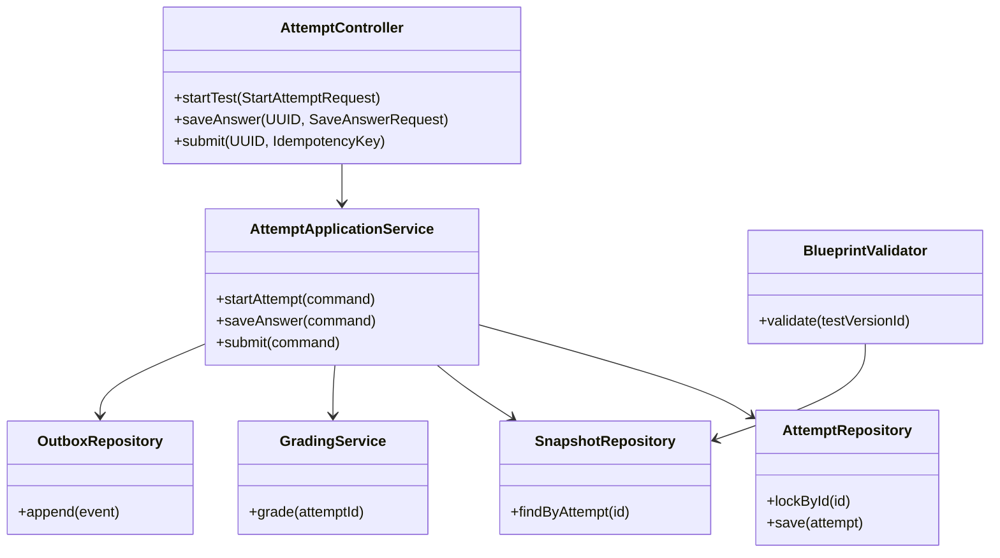
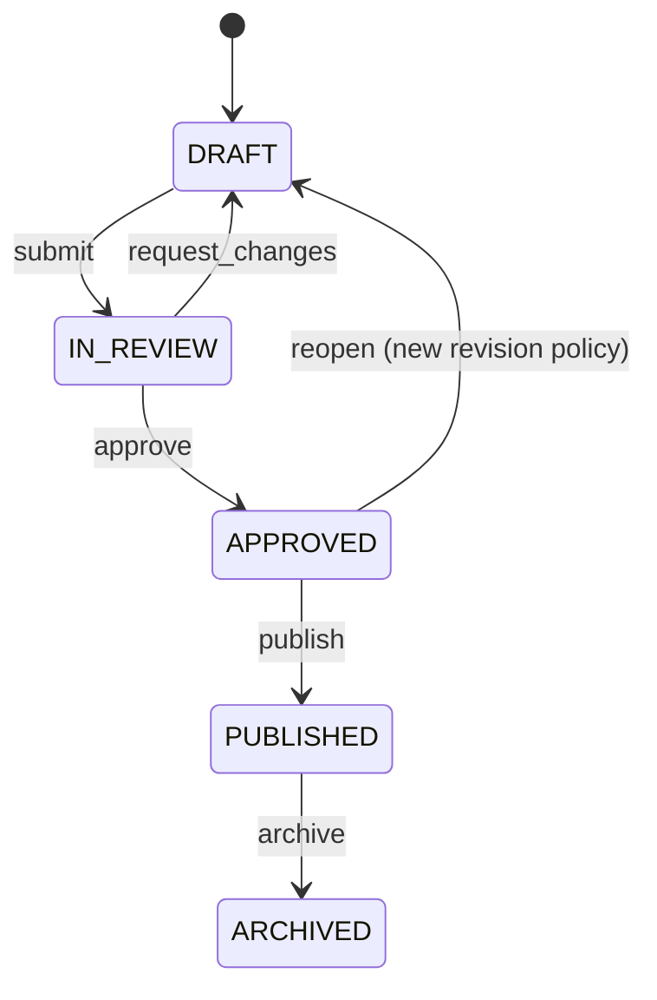
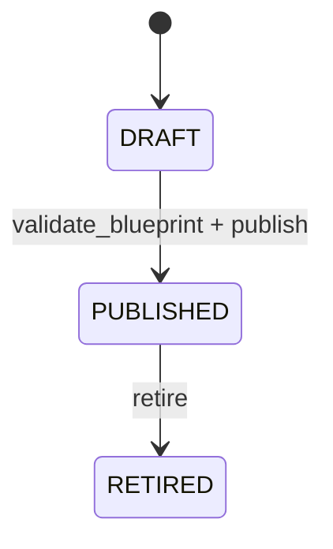
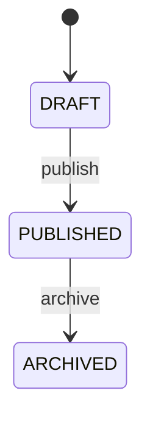
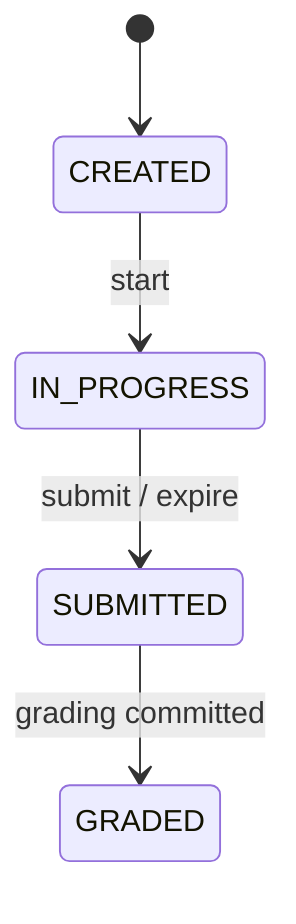
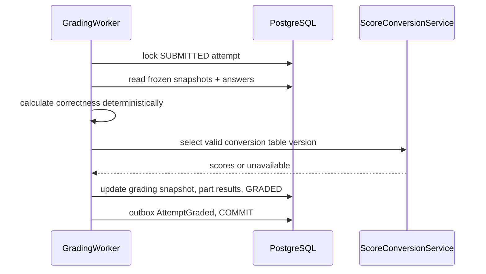
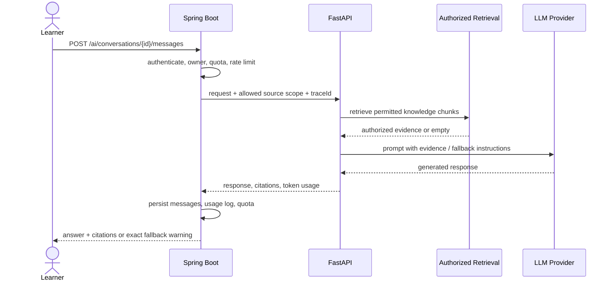

# TOEIC Learning Platform — Low-Level Design (LLD) v1.0

> **SYNC REVIEW v1.7 — 2026-10-28 | Trạng thái: đồng bộ tài liệu, CHƯA freeze/validate runtime**
> **Đồng bộ:** Danh mục bảng ở §7.1 được trích từ ERD v1.3 cũ và chỉ mang tính lịch sử, **không phải schema v1.6 hiện hành**. ERD v1.6 đã sửa trùng `learning_progress.content_id` và bổ sung `question_versions.status`. Các vấn đề còn mở: `attempt_answers.client_sequence` chưa persisted; `review_history.rating` integer khác API enum chuỗi; chưa có `idempotency_requests`/`auth_sessions` trong ERD v1.6. Không tự coi thuật toán 4 mức SRS đã được freeze.
> Tài liệu liên quan: [SRS](SRS.md) · [HLD](HLD.md) · [LLD](LLD.md) · [API](API_Specification.md) · [ERD v1.6](ERD_v1.6.md).


> **Status:** Design draft for review, not implementation proof. **Baseline:** SRS v1.2, ERD/DBML v1.3, SAD/HLD v1.1. **Language:** Vietnamese, identifiers English. **Date:** 2026-10-28.
>
> **Phân loại:** [BASELINE] kế thừa yêu cầu đã mô tả; [DESIGN] lựa chọn triển khai ở LLD; [OPEN] phải xác nhận trước khi freeze. API contract chi tiết nằm trong `TOEIC_API_Specification_v1.0.md`.

## 1. Mục tiêu, phạm vi và ranh giới

LLD cụ thể hóa controller, application service, domain service, repository, DTO, transaction, state machine, authorization, consistency, background job, event và testing. Không thay thế ERD, SRS hay HLD. Spring Boot modular monolith là nguồn sự thật cho nghiệp vụ; FastAPI chỉ xử lý RAG/LLM. Client React/React Native không chấm điểm và không quyết định thời gian thi.

### 1.1 Nguyên tắc kỹ thuật

- Module nội bộ chỉ được dùng `public application interfaces`/events của module khác; không gọi repository của module khác trực tiếp.
- `@Transactional` ở application use case; tránh giữ transaction mở khi gọi LLM/object storage.
- Các version đã PUBLISHED không sửa nội dung; sửa bằng phiên bản mới. Attempt lưu tập câu hỏi bất biến.
- Mọi truy vấn tài nguyên cá nhân cần object-level authorization, không chỉ kiểm tra role.
- Dữ liệu thời gian UTC (`timestamptz` khi triển khai); UUID; tiền tệ AI cost dạng `numeric`, không dùng floating-point.
- Domain events có outbox trong cùng transaction; publisher retry và consumer idempotent.
- Mọi request write có validation, audit cho hành động nhạy cảm; lỗi trả theo error envelope thống nhất.

### 1.2 Cấu trúc source code [DESIGN]

```text
backend/src/main/java/com/toeic/platform/
  identity/{api,application,domain,infrastructure}/
  content/{api,application,domain,infrastructure}/
  questionbank/{api,application,domain,infrastructure}/
  assessment/{api,application,domain,infrastructure}/
  vocabulary/{api,application,domain,infrastructure}/
  listening/{api,application,domain,infrastructure}/
  analytics/{api,application,domain,infrastructure}/
  notification/{api,application,domain,infrastructure}/
  ai/{api,application,domain,infrastructure}/
  system/{api,application,domain,infrastructure}/
  shared/{security,exception,events,clock,pagination}/
```

`api`: controllers + request/response; `application`: commands/queries/use cases + transaction; `domain`: invariants + policies; `infrastructure`: JPA, external adapters, schedulers.

## 2. Thiết kế module chi tiết

### 2.1 Identity & Authorization

**Tables:** `users`, `roles`, `permissions`, `user_roles`, `role_permissions`, `learning_profiles`.

| Layer | Thành phần |
|---|---|
| API | `AuthController`, `UserController`, `AdminUserController` |
| Application/domain | `AuthService`, `UserProfileService`, `PermissionService` |
| Persistence/adapters | `UserRepository`, `RoleRepository`, `RefreshTokenAdapter (nếu được duyệt)` |
| Use cases | Register, Login, Logout, Me, AssignRole |

**Invariants:** Không trả password_hash; role assignment chỉ admin; ownership check.

**Mẫu interface [DESIGN]:** `CommandService.execute(Command, ActorContext) -> Result`; query sử dụng `QueryService` riêng, DTO không expose JPA entity. Mọi write xác thực quyền, validation, transaction, audit/outbox nếu có sự kiện. Unit tests cho business rules, integration tests cho persistence và HTTP tests cho controller.

### 2.2 Learning Content & Media

**Tables:** `learning_contents`, `learning_content_versions`, `content_categories`, `content_resources`, `media_resources`, `learning_progress`, `bookmarks`.

| Layer | Thành phần |
|---|---|
| API | `ContentController`, `ContentAuthoringController`, `MediaController` |
| Application/domain | `ContentVersionService`, `ContentPublishService`, `LearningProgressService`, `MediaService` |
| Persistence/adapters | `ContentRepository`, `ContentVersionRepository`, `ProgressRepository`, `MediaRepository` |
| Use cases | CreateDraft, SubmitContent, PublishContent, CompleteContent, GetPublishedVersion |

**Invariants:** Chỉ hiển thị published; progress tham chiếu content version đã học; media soft-delete.

**Mẫu interface [DESIGN]:** `CommandService.execute(Command, ActorContext) -> Result`; query sử dụng `QueryService` riêng, DTO không expose JPA entity. Mọi write xác thực quyền, validation, transaction, audit/outbox nếu có sự kiện. Unit tests cho business rules, integration tests cho persistence và HTTP tests cho controller.

### 2.3 Question Bank

**Tables:** `questions`, `question_versions`, `question_choices`, `question_groups`, `question_group_versions`, `question_group_version_resources`, `question_resources`, `tags`, `question_tags`, `error_categories`, `question_error_categories`.

| Layer | Thành phần |
|---|---|
| API | `QuestionController`, `QuestionWorkflowController`, `TagController` |
| Application/domain | `QuestionVersionService`, `QuestionReviewService`, `QuestionPublishService`, `QuestionSearchService` |
| Persistence/adapters | `QuestionRepository`, `QuestionVersionRepository`, `GroupVersionRepository` |
| Use cases | CreateQuestion, CreateVersion, SubmitReview, Approve, Publish, Archive |

**Invariants:** Choices gắn version; không chỉnh version published; group version khớp question.

**Mẫu interface [DESIGN]:** `CommandService.execute(Command, ActorContext) -> Result`; query sử dụng `QueryService` riêng, DTO không expose JPA entity. Mọi write xác thực quyền, validation, transaction, audit/outbox nếu có sự kiện. Unit tests cho business rules, integration tests cho persistence và HTTP tests cho controller.

### 2.4 Assessment & Blueprint

**Tables:** `tests`, `test_versions`, `test_questions`, `test_blueprints`, `test_blueprint_items`, `attempts`, `attempt_question_snapshots`, `attempt_answers`, `attempt_part_results`, `score_conversion_tables`, `score_conversion_rules`.

| Layer | Thành phần |
|---|---|
| API | `TestController`, `BlueprintController`, `AttemptController`, `ScoreController` |
| Application/domain | `TestPublishService`, `BlueprintValidator`, `AttemptService`, `AnswerService`, `SubmissionService`, `GradingService`, `ScoreConversionService` |
| Persistence/adapters | `TestRepository`, `AttemptRepository`, `SnapshotRepository`, `AnswerRepository` |
| Use cases | PublishTest, StartAttempt, Autosave, Submit, Expire, Grade, ReadResult |

**Invariants:** Row lock/unique; immutable snapshots; server expires_at; idempotent submit.

**Mẫu interface [DESIGN]:** `CommandService.execute(Command, ActorContext) -> Result`; query sử dụng `QueryService` riêng, DTO không expose JPA entity. Mọi write xác thực quyền, validation, transaction, audit/outbox nếu có sự kiện. Unit tests cho business rules, integration tests cho persistence và HTTP tests cho controller.

### 2.5 Vocabulary & SRS

**Tables:** `vocabulary_decks`, `vocabularies`, `deck_vocabularies`, `review_states`, `review_history`.

| Layer | Thành phần |
|---|---|
| API | `VocabularyController`, `DeckController`, `ReviewController` |
| Application/domain | `VocabularyService`, `DeckService`, `ReviewScheduler`, `ReviewService` |
| Persistence/adapters | `VocabularyRepository`, `ReviewStateRepository`, `ReviewHistoryRepository` |
| Use cases | AddVocabulary, AddToDeck, GetDue, ReviewVocabulary |

**Invariants:** 1 vocabulary = 1 flashcard; UNIQUE(user_id,vocabulary_id); update state + append history atomic.

**Mẫu interface [DESIGN]:** `CommandService.execute(Command, ActorContext) -> Result`; query sử dụng `QueryService` riêng, DTO không expose JPA entity. Mọi write xác thực quyền, validation, transaction, audit/outbox nếu có sự kiện. Unit tests cho business rules, integration tests cho persistence và HTTP tests cho controller.

### 2.6 Listening Practice

**Tables:** `dictation_exercises`, `dictation_attempts`, `dictation_answers`, `shadowing_exercises`, `shadowing_attempts`, `shadowing_feedback`, `media_resources`.

| Layer | Thành phần |
|---|---|
| API | `DictationController`, `ShadowingController` |
| Application/domain | `DictationService`, `DictationGrader`, `ShadowingService`, `RecordingService` |
| Persistence/adapters | `DictationRepository`, `ShadowingRepository`, `MediaRepository` |
| Use cases | StartDictation, SubmitDictation, StartShadowing, SubmitRecording |

**Invariants:** Recording storage controlled; audio permissions; automated shadowing feedback optional.

**Mẫu interface [DESIGN]:** `CommandService.execute(Command, ActorContext) -> Result`; query sử dụng `QueryService` riêng, DTO không expose JPA entity. Mọi write xác thực quyền, validation, transaction, audit/outbox nếu có sự kiện. Unit tests cho business rules, integration tests cho persistence và HTTP tests cho controller.

### 2.7 Analytics & Recommendation

**Tables:** `part_performance`, `recommendations`, `user_error_statistics`, `learning_profiles`, `attempt_part_results`.

| Layer | Thành phần |
|---|---|
| API | `AnalyticsController`, `RecommendationController` |
| Application/domain | `ProgressQueryService`, `PerformanceAggregator`, `RecommendationService` |
| Persistence/adapters | `PerformanceRepository`, `RecommendationRepository` |
| Use cases | GetDashboard, GetPartStats, GenerateRecommendation |

**Invariants:** Read model eventual consistency; không sửa lịch sử Attempt.

**Mẫu interface [DESIGN]:** `CommandService.execute(Command, ActorContext) -> Result`; query sử dụng `QueryService` riêng, DTO không expose JPA entity. Mọi write xác thực quyền, validation, transaction, audit/outbox nếu có sự kiện. Unit tests cho business rules, integration tests cho persistence và HTTP tests cho controller.

### 2.8 AI Tutor & RAG

**Tables:** `ai_conversations`, `ai_messages`, `ai_message_sources`, `ai_request_logs`, `ai_configs`, `knowledge_documents`, `knowledge_chunks`.

| Layer | Thành phần |
|---|---|
| API | `AiConversationController`, `AiAdminController` |
| Application/domain | `AiTutorService`, `AiQuotaService`, `RetrievalAuthorizationService`, `AiUsageService` |
| Persistence/adapters | `AiConversationRepository`, `AiUsageLogRepository`, `AiServiceClient` |
| Use cases | CreateConversation, AskTutor, GetMessages, GetUsage |

**Invariants:** No fabricated citations; permission filter; quota/rate limit; fallback exact warning.

**Mẫu interface [DESIGN]:** `CommandService.execute(Command, ActorContext) -> Result`; query sử dụng `QueryService` riêng, DTO không expose JPA entity. Mọi write xác thực quyền, validation, transaction, audit/outbox nếu có sự kiện. Unit tests cho business rules, integration tests cho persistence và HTTP tests cho controller.

### 2.9 Notification

**Tables:** `notifications`, `user_notifications`.

| Layer | Thành phần |
|---|---|
| API | `NotificationController`, `NotificationAdminController` |
| Application/domain | `NotificationService`, `NotificationDispatchService` |
| Persistence/adapters | `NotificationRepository`, `UserNotificationRepository` |
| Use cases | ListNotifications, MarkRead, DispatchEventNotification |

**Invariants:** In-app MVP; dedupe event+recipient+template; unread count.

**Mẫu interface [DESIGN]:** `CommandService.execute(Command, ActorContext) -> Result`; query sử dụng `QueryService` riêng, DTO không expose JPA entity. Mọi write xác thực quyền, validation, transaction, audit/outbox nếu có sự kiện. Unit tests cho business rules, integration tests cho persistence và HTTP tests cho controller.

### 2.10 System, Audit & Outbox

**Tables:** `audit_logs`, `system_settings`, `outbox_events`.

| Layer | Thành phần |
|---|---|
| API | `SystemAdminController` |
| Application/domain | `AuditService`, `SettingsService`, `OutboxPublisher` |
| Persistence/adapters | `AuditRepository`, `SettingsRepository`, `OutboxRepository` |
| Use cases | AuditAction, UpdateSettings, PublishOutbox |

**Invariants:** Không chứa secrets plaintext; outbox at-least-once; redact PII.

**Mẫu interface [DESIGN]:** `CommandService.execute(Command, ActorContext) -> Result`; query sử dụng `QueryService` riêng, DTO không expose JPA entity. Mọi write xác thực quyền, validation, transaction, audit/outbox nếu có sự kiện. Unit tests cho business rules, integration tests cho persistence và HTTP tests cho controller.

## 3. Class/Component Diagram [DESIGN]



### 3.1 Các DTO/command quan trọng

| Command/DTO | Trường cốt lõi | Kiểm tra |
|---|---|---|
| `RegisterRequest` | email, password, fullName | email unique; password policy |
| `CreateQuestionVersionRequest` | questionId, text, choices, groupVersionId | ít nhất một đáp án đúng theo question type |
| `PublishTestCommand` | testVersionId, expectedVersion | tất cả câu hỏi/group đã publish; blueprint hợp lệ |
| `StartAttemptRequest` | testVersionId hoặc practice filter | nguồn đề hợp lệ; attempt limit |
| `SaveAnswerRequest` | questionVersionId, selectedChoiceId, clientSequence | choice thuộc question version; attempt in progress |
| `ReviewVocabularyRequest` | vocabularyId, rating | Again/Hard/Good/Easy; owner |
| `AskTutorRequest` | conversationId, message | quota, size, authorized sources |
| `MarkNotificationRead` | userNotificationId | recipient là actor |

**[OPEN]** `clientSequence` hoặc `expectedRevision` cần cột tương ứng nếu muốn optimistic concurrency autosave. DBML v1.3 chưa định nghĩa rõ revision. Không hứa bảo đảm last-write-wins chính xác nếu chưa chốt policy.

## 4. State machines và quy tắc chuyển trạng thái

### 4.1 QuestionVersion



`approve` phải khác người soạn nếu policy yêu cầu [OPEN]. Published immutable; `ARCHIVED` không xóa dữ liệu đã được attempt/test tham chiếu. **Schema gap:** `question_versions` trong DBML v1.3 chưa có cột `status` dù tài liệu workflow yêu cầu; cần bổ sung trước freeze.

### 4.2 TestVersion



`PUBLISHED` và `RETIRED` bất biến nội dung; retired không cho tạo attempt mới, nhưng attempt đang chạy và lịch sử vẫn truy cập được.

### 4.3 LearningContentVersion



### 4.4 Attempt



`expires_at` authoritative; `SUBMITTED` đóng quyền autosave; grading retry từ `SUBMITTED`; `GRADED` immutable. Nếu cần trạng thái lỗi grading, dùng retry metadata/job status riêng [DESIGN], không tự ý thêm trạng thái Attempt trái baseline.

## 5. Sequence diagrams và transaction boundaries

### 5.1 Start Attempt, max_attempts và snapshot

```mermaid
sequenceDiagram
 actor L as Learner
 participant C as AttemptController
 participant S as AttemptService
 participant DB as PostgreSQL
 L->>C: POST /attempts
 C->>S: start(actor, source)
 S->>DB: BEGIN; lock test/user policy scope
 S->>DB: validate published, max_attempts
 S->>DB: insert attempt + immutable snapshots
 S->>DB: insert outbox AttemptStarted; COMMIT
 S-->>C: attemptId, expiresAt
 C-->>L: 201 Created
```

**Race control:** giới hạn số lượt thi cần serialization theo `(user_id,test_version_id)` hoặc advisory lock/row policy; chỉ `COUNT(*)` rồi insert là race-prone. `max_attempts=NULL` = không giới hạn. Snapshot tạo atomically với Attempt.

### 5.2 Autosave đồng thời Submit

```mermaid
sequenceDiagram
 actor L as Learner
 participant API as AttemptController
 participant DB as PostgreSQL
 L->>API: PUT answer
 API->>DB: BEGIN; SELECT attempt FOR UPDATE
 DB-->>API: status, expires_at
 API->>DB: validate IN_PROGRESS and time
 API->>DB: UPSERT answer, COMMIT
 L->>API: POST submit (Idempotency-Key)
 API->>DB: BEGIN; SELECT attempt FOR UPDATE
 API->>DB: transition SUBMITTED once; outbox; COMMIT
 API-->>L: 200 submission receipt
```

**Policy:** nếu submit lấy lock trước thì autosave sau bị từ chối `ATTEMPT_NOT_EDITABLE`; nếu autosave commit trước thì submit chấm trên đáp án đã lưu. Client không được coi autosave thành công khi HTTP chưa xác nhận. **[OPEN]** cơ chế lưu idempotency key: DBML chưa có `idempotency_requests`/unique request key; có thể dùng transaction status + receipt cho submit, nhưng để replay chính xác HTTP response cần bổ sung storage.

### 5.3 Grading/recovery



Grading idempotent: update chỉ khi `status=SUBMITTED`, upsert part results với unique `(attempt_id,part_id)`. Nếu crash trước commit, retry; nếu crash sau commit, không chấm lần hai. `is_correct` là snapshot kết quả chấm theo đáp án version đã đóng băng, không phải nguồn đáp án độc lập.

### 5.4 Content publish và notification

```mermaid
sequenceDiagram
 actor T as Teacher
 participant P as PublishService
 participant DB as PostgreSQL
 participant O as OutboxWorker
 participant N as NotificationService
 T->>P: publish approved version
 P->>DB: lock version; validate transitions + references
 P->>DB: mark PUBLISHED, pointer, audit, outbox; COMMIT
 O->>DB: poll unpublished outbox
 O->>N: LearningContentPublished(eventId)
 N->>DB: insert notification + recipient dedupe
 O->>DB: mark delivered / retry
```

### 5.5 AI Tutor/RAG



Khi không có tài liệu đáng tin cậy: phải hiển thị **“Không tìm thấy tài liệu tham khảo trong hệ thống.”**; không bịa citations. Nếu FastAPI/LLM lỗi, các chức năng học và thi vẫn hoạt động.

## 6. Thuật toán và business logic

### 6.1 Blueprint validation

1. Lấy blueprint gắn với test version; kiểm tra loại đề và trạng thái blueprint.
2. Đếm câu theo Part và nhóm theo `question_group_version_id`; đối chiếu `test_blueprint_items`.
3. Xác nhận tất cả `QuestionVersion`, `QuestionGroupVersion` đều đã publish, không có bản nháp, thiếu media, duplicate order, thiếu answer key.
4. Xác nhận tổng câu, skill, thời lượng, giới hạn lượt; nếu lỗi trả danh sách `fieldErrors` và không publish.
5. Sau publish, không cho thay đổi mapping test_questions, blueprint version, max_attempts, duration, answer key.

Full Mock tham khảo 200 câu: P1=6, P2=25, P3=39, P4=30, P5=30, P6=16, P7=54. Section/Dynamic Practice dùng blueprint phù hợp, không áp dụng cấu trúc 200 câu bắt buộc.

### 6.2 SM-2 simplified [DESIGN]

```text
review(user, vocabulary, rating, now):
  BEGIN; lock review_states(user,vocabulary)
  rating ∈ {AGAIN,HARD,GOOD,EASY}
  compute next repetition_count, interval_days, ease_factor
  next_review_at = now + interval
  UPDATE review_states
  INSERT review_history (rating, previous_state, new_state, reviewed_at)
  INSERT outbox VocabularyReviewed
  COMMIT
```

**[OPEN]** công thức cụ thể cho 4 rating và giới hạn ease factor chưa được chốt bằng SRS/DBML. Không mặc định đây là SM-2 nguyên bản; phải chốt bảng chuyển interval và unit tests trước khi code.

### 6.3 Score conversion

- Chỉ áp dụng bảng quy đổi đang hợp lệ tại thời điểm grading, lưu `score_conversion_table_id` cố định trên Attempt.
- Bảng đã từng được dùng không sửa rule; retire chỉ chặn dùng mới.
- Không có bảng hợp lệ → chỉ trả raw Listening/Reading correct counts; estimated score = `null`.
- Nhãn hiển thị **estimated TOEIC score**, không tuyên bố là điểm ETS chính thức.

### 6.4 Error category analytics

Map question→error categories ở version/metadata; nếu taxonomy thay đổi cần policy lịch sử. Aggregate `user_error_statistics` từ `AttemptGraded` qua idempotent consumer; không làm chậm transaction chấm điểm.

### 6.5 Notification

Tạo từ `AttemptGraded`, `VocabularyReviewed`/due scheduler, `LearningContentPublished`, `RecommendationGenerated`, AI quota warnings. Notification recipient dedupe; API list/read/unread; không gửi push/email trong MVP.

## 7. Persistence mapping & schema review gate

**Quan trọng:** DBML v1.3 vẫn là logical design, chưa migration-tested. Khi đọc file DBML trực tiếp phát hiện ít nhất hai vấn đề cần xử lý trước khi tạo JPA entities:

1. `learning_progress` khai báo `content_id uuid [not null]` **hai lần** → cần xóa một dòng trùng.
2. `question_versions` **chưa có cột `status`**, trong khi workflow yêu cầu DRAFT/IN_REVIEW/APPROVED/PUBLISHED/ARCHIVED → bổ sung và chuẩn hóa.

Ngoài ra phải kiểm tra FK cho `learning_contents.current_published_version_id`, `learning_progress.completed_content_version_id`, `attempt_answers.selected_choice_id` composite reference, `test_questions.question_group_version_id`, cùng constraints `expires_at > started_at`, source-type conditional FK, unique keys, version immutability, outbox indexes.

### 7.1 Danh mục bảng theo ERD v1.3

| Table | Các cột từ DBML (lược bỏ comment) |
|---|---|

| `users` | `user_id`, `email`, `password_hash`, `full_name`, `avatar_url`, `status`, `email_verified_at`, `last_login_at`, `created_at`, `updated_at` |

| `roles` | `role_id`, `name`, `description` |

| `permissions` | `permission_id`, `code`, `description` |

| `user_roles` | `user_id`, `role_id`, `assigned_at` |

| `role_permissions` | `role_id`, `permission_id` |

| `content_categories` | `category_id`, `code`, `name`, `description` |

| `learning_contents` | `current_published_version_id`, `content_id`, `category_id`, `author_id`, `title`, `summary`, `body`, `difficulty`, `status`, `published_at`, `created_at`, `updated_at` |

| `media_resources` | `resource_id`, `resource_type`, `storage_url`, `mime_type`, `file_size`, `duration_seconds`, `transcript`, `created_at` |

| `content_resources` | `content_id`, `resource_id` |

| `learning_progress` | `completed_content_version_id`, `progress_id`, `user_id`, `content_id`, `status`, `progress_percent`, `started_at`, `completed_at`, `last_accessed_at` |

| `bookmarks` | `user_id`, `content_id`, `created_at` |

| `toeic_parts` | `part_id`, `part_number`, `skill`, `name` |

| `topics` | `topic_id`, `name`, `description` |

| `question_types` | `question_type_id`, `code`, `name`, `description` |

| `question_groups` | `group_id`, `group_type`, `created_at`, `updated_at` |

| `questions` | `question_id`, `group_id`, `part_id`, `topic_id`, `question_type_id`, `created_by`, `status`, `created_at`, `updated_at` |

| `question_versions` | `reviewed_by`, `reviewed_at`, `approved_by`, `approved_at`, `published_at`, `archived_at`, `group_version_id`, `question_version_id`, `question_id`, `version_number`, `question_text`, `explanation`, `difficulty`, `created_at` |

| `question_choices` | `choice_id`, `question_version_id`, `choice_label`, `content`, `is_correct`, `display_order` |

| `question_resources` | `question_version_id`, `resource_id` |

| `tests` | `test_id`, `created_by`, `title`, `description`, `test_type`, `status`, `created_at`, `updated_at` |

| `test_versions` | `blueprint_id`, `retired_at`, `max_attempts`, `test_version_id`, `test_id`, `version_number`, `duration_seconds`, `total_questions`, `status`, `published_at`, `created_at` |

| `test_questions` | `test_version_id`, `question_version_id`, `question_group_version_id`, `question_order`, `points` |

| `attempts` | `attempt_id`, `user_id`, `test_version_id`, `attempt_type`, `attempt_source_type`, `expires_at`, `max_attempts_snapshot`, `status`, `started_at`, `submitted_at`, `duration_seconds`, `total_questions`, `correct_count`, `listening_correct_count`, `reading_correct_count`, `listening_estimated_score`, `reading_estimated_score`, `total_estimated_score`, `score_conversion_table_id`, `created_at` |

| `attempt_answers` | `attempt_answer_id`, `attempt_id`, `question_version_id`, `selected_choice_id`, `is_correct`, `answered_at`, `updated_at` |

| `attempt_part_results` | `attempt_part_result_id`, `attempt_id`, `part_id`, `total_questions`, `correct_count`, `accuracy` |

| `vocabulary_decks` | `deck_id`, `user_id`, `name`, `description`, `created_at`, `updated_at` |

| `vocabularies` | `part_of_speech`, `pronunciation_audio_resource_id`, `vocabulary_id`, `created_by`, `word`, `meaning`, `pronunciation`, `example`, `note`, `created_at`, `updated_at` |

| `deck_vocabularies` | `deck_id`, `vocabulary_id`, `added_at` |

| `review_states` | `review_state_id`, `user_id`, `vocabulary_id`, `repetition_count`, `interval_days`, `ease_factor`, `last_reviewed_at`, `next_review_at` |

| `review_history` | `review_history_id`, `review_state_id`, `rating`, `previous_interval`, `new_interval`, `reviewed_at` |

| `learning_profiles` | `profile_id`, `user_id`, `target_score`, `estimated_score`, `listening_level`, `reading_level`, `updated_at` |

| `part_performance` | `performance_id`, `user_id`, `part_id`, `attempted_questions`, `correct_questions`, `accuracy`, `mastery_score`, `updated_at` |

| `recommendations` | `recommendation_id`, `user_id`, `recommendation_type`, `title`, `description`, `source`, `priority`, `generated_at`, `expires_at` |

| `ai_conversations` | `conversation_id`, `user_id`, `title`, `created_at`, `updated_at` |

| `ai_messages` | `message_id`, `conversation_id`, `role`, `content`, `created_at` |

| `knowledge_documents` | `learning_content_version_id`, `document_id`, `title`, `source_type`, `source_url`, `status`, `created_at`, `updated_at` |

| `knowledge_chunks` | `learning_content_version_id`, `chunk_id`, `document_id`, `chunk_index`, `content`, `embedding`, `embedding_model`, `created_at` |

| `ai_message_sources` | `message_id`, `chunk_id`, `relevance_score` |

| `ai_configs` | `config_id`, `config_key`, `config_value`, `description`, `updated_by`, `updated_at` |

| `dictation_exercises` | `dictation_id`, `title`, `instruction`, `audio_resource_id`, `transcript`, `difficulty`, `status`, `created_by`, `created_at`, `updated_at` |

| `dictation_attempts` | `attempt_id`, `dictation_id`, `user_id`, `status`, `score`, `started_at`, `completed_at`, `created_at` |

| `dictation_answers` | `answer_id`, `attempt_id`, `user_text`, `accuracy`, `submitted_at` |

| `shadowing_exercises` | `shadowing_id`, `title`, `instruction`, `audio_resource_id`, `transcript`, `difficulty`, `status`, `created_by`, `created_at`, `updated_at` |

| `shadowing_attempts` | `attempt_id`, `shadowing_id`, `user_id`, `recording_resource_id`, `status`, `pronunciation_score`, `fluency_score`, `overall_score`, `started_at`, `completed_at`, `created_at` |

| `shadowing_feedback` | `feedback_id`, `attempt_id`, `feedback_type`, `feedback_text`, `created_at` |

| `question_group_versions` | `group_version_id`, `group_id`, `version_number`, `instruction`, `passage_text`, `created_at` |

| `question_group_version_resources` | `group_version_id`, `resource_id`, `display_order` |

| `attempt_question_snapshots` | `snapshot_id`, `attempt_id`, `question_version_id`, `question_group_version_id`, `question_order`, `points`, `created_at` |

| `score_conversion_tables` | `score_conversion_table_id`, `name`, `version_number`, `status`, `activated_at`, `created_at` |

| `score_conversion_rules` | `rule_id`, `score_conversion_table_id`, `skill`, `correct_count`, `estimated_score` |

| `audit_logs` | `audit_id`, `actor_user_id`, `action`, `entity_type`, `entity_id`, `details`, `created_at` |

| `system_settings` | `setting_key`, `setting_value`, `updated_by`, `updated_at` |

| `learning_content_versions` | `content_version_id`, `content_id`, `version_number`, `title`, `summary`, `body`, `status`, `published_at`, `archived_at`, `created_by`, `created_at`, `updated_at` |

| `tags` | `tag_id`, `code`, `name`, `created_at`, `updated_at` |

| `question_tags` | `question_id`, `tag_id`, `created_at` |

| `test_blueprints` | `blueprint_id`, `code`, `version_number`, `name`, `blueprint_type`, `status`, `expected_total_questions`, `created_at`, `updated_at` |

| `test_blueprint_items` | `blueprint_item_id`, `blueprint_id`, `part_id`, `expected_question_count`, `expected_group_count` |

| `ai_request_logs` | `request_id`, `conversation_id`, `user_id`, `provider`, `model`, `prompt_tokens`, `completion_tokens`, `total_tokens`, `latency_ms`, `estimated_cost`, `cost_currency`, `status`, `error_code`, `created_at` |

| `notifications` | `notification_id`, `notification_type`, `title`, `body`, `payload_json`, `created_at` |

| `user_notifications` | `user_notification_id`, `notification_id`, `user_id`, `delivery_status`, `delivered_at`, `read_at`, `created_at` |

| `error_categories` | `error_category_id`, `code`, `name`, `description`, `created_at`, `updated_at` |

| `question_error_categories` | `question_id`, `error_category_id` |

| `user_error_statistics` | `user_id`, `error_category_id`, `attempted_count`, `incorrect_count`, `updated_at` |

| `outbox_events` | `event_id`, `event_type`, `aggregate_type`, `aggregate_id`, `payload_json`, `status`, `occurred_at`, `processed_at`, `retry_count` |

### 7.2 Transaction and locking matrix

| Use case | Transaction | Lock/unique | Retry policy |
|---|---|---|---|
| Register | user + default role | unique email | duplicate → 409 |
| Publish question/test/content | version + pointer + audit + outbox | version row lock | 409 conflict |
| Start attempt | attempt + snapshots + outbox | serialize user/test quota | safe retry with idempotency design |
| Autosave | answer upsert | attempt row lock | reject after submit |
| Submit | status transition + outbox | attempt row lock | return same receipt |
| Grade | results + status + outbox | attempt row lock | retry worker |
| SRS review | review_state + review_history | unique user/vocab + row lock | avoid duplicate reviews |
| Mark notification read | recipient row | owner filter | idempotent |

### 7.3 PostgreSQL indexing guidance [DESIGN]

`attempts(user_id,started_at DESC)`, `attempts(status,expires_at)`, `attempt_answers(attempt_id,question_version_id)`, `review_states(user_id,next_review_at)`, `user_notifications(user_id,read_at,created_at DESC)`, `outbox_events(status,created_at)`, `ai_request_logs(user_id,created_at)` nếu có user_id trong schema, `knowledge_chunks` vector index chỉ sau khi xác nhận embedding dimension/model. Kiểm tra indexes hiện có để tránh trùng.

## 8. Security, error handling, observability

- Password hash dùng Argon2id/bcrypt; không lưu plaintext; refresh-token strategy là [OPEN] vì DBML hiện chưa có token table.
- JWT access token có expiry ngắn; server xác thực issuer, audience, signature, roles/permissions; không tin `userId` từ client cho resource cá nhân.
- RBAC và ownership kiểm tra trong service trước khi đọc/sửa dữ liệu; kiểm tra object-level authorization cho AI retrieval.
- Media upload: MIME whitelist, size limit, signed URL nếu private; soft-delete khi đang được tham chiếu.
- PII không đưa vào prompt/log trừ khi thật cần; redaction, retention policy, audit access.
- API lỗi thống nhất: `code`, `message`, `traceId`, `details`; không trả stack trace hay SQL.
- Logs JSON có traceId, requestId, actorId (khi hợp lệ), operation, latency; metrics request latency, DB pool, grading queue, AI tokens/cost, outbox lag.

## 9. Test design / verification matrix

| ID | Scenario | Expected |
|---|---|---|
| T01 | 2 start attempt cùng lúc khi còn 1 slot | đúng 1 thành công |
| T02 | 2 submit đồng thời | 1 state transition; cùng receipt |
| T03 | autosave và submit race | không có write sau submit |
| T04 | expire khi browser đóng | server auto submit |
| T05 | question publish mới khi attempt đang chạy | attempt vẫn dùng version cũ |
| T06 | test retire khi attempt đang chạy | attempt hiện tại vẫn hoàn tất |
| T07 | conversion table retire sau grading | điểm lịch sử không đổi |
| T08 | grading worker crash/retry | không double-count/event duplicate effects |
| T09 | media delete khi được tham chiếu | bị từ chối hoặc soft-delete an toàn |
| T10 | AI retrieval tài liệu không có quyền | không trả source/content |
| T11 | teacher gọi admin role endpoint | 403 |
| T12 | learner truy cập attempt người khác | 404 hoặc 403 nhất quán |
| T13 | snapshot/choice version mismatch | 422 hoặc 409, không ghi sai |
| T14 | no valid score conversion | raw counts, scores null |
| T15 | outbox publish lặp | consumer dedupe |
| T16 | SM-2 review race | không mất lịch sử, state consistent |
| T17 | blueprint Part 3 có sai group count | publish bị chặn |
| T18 | AI no source | exact warning, citations empty |

## 10. Requirements traceability & open decisions

| Requirement | LLD design | API family | Validation |
|---|---|---|---|
| UC-01/02 | Identity | `/auth`, `/users/me` | T11/T12 |
| UC-03 | Learning Content | `/contents` | version immutability |
| UC-04/05/06 | Assessment | `/tests`, `/attempts` | T01–T08, T13–T14 |
| UC-07/08 | Listening | `/dictations`, `/shadowing` | recording security |
| UC-09 | Vocabulary/SRS | `/vocabularies`, `/reviews` | T16 |
| UC-10 | Analytics | `/analytics` | aggregation correctness |
| UC-11 | AI Tutor | `/ai` | T10/T18 |
| UC-12/13/14 | Teacher publishing | `/contents`, `/questions`, `/tests` | workflow/blueprint |
| UC-15 | RBAC | `/admin/users`, `/admin/roles` | T11 |

**Open issues before implementation:** [OPEN-01] QuestionVersion status column; [OPEN-02] duplicate `learning_progress.content_id`; [OPEN-03] autosave revision/idempotency storage; [OPEN-04] exact SM-2 intervals; [OPEN-05] media ownership and object storage; [OPEN-06] auth refresh token/revocation; [OPEN-07] AI provider/model/embedding dimension; [OPEN-08] score conversion governance; [OPEN-09] publish approval separation; [OPEN-10] endpoint field names vs schema migration.

## 11. Definition of Done (LLD)

- [ ] Mỗi UC có command/query, DTO, authorization, errors, persistence mapping.
- [ ] Sequence diagrams cho publish, start, autosave, submit, grade, SRS, AI.
- [ ] Transaction/race policy có integration tests.
- [ ] API Spec nhất quán với DBML và các state machines.
- [ ] Schema gaps được sửa trước migration.
- [ ] Không có endpoint ghi trực tiếp vào published versions.
- [ ] Review của BA/Architect/Backend/QA hoàn tất.


## Phụ lục — Đồng bộ liên tài liệu v1.7

| Hạng mục | Quy ước liên tài liệu | Trạng thái |
|---|---|---|
| Nguồn yêu cầu | SRS v1.2 | Draft chờ phê duyệt |
| Kiến trúc | HLD v1.1 Phần B ưu tiên; module `content` theo LLD | Design review |
| Schema | ERD v1.6 là bản logical hiện tại | Chưa kiểm chứng PostgreSQL |
| HTTP errors | `code`, `message`, `traceId`, `details` | API proposal |
| Review rating | API chuỗi, ERD integer | **OPEN — cần mapping hoặc migration** |
| Autosave concurrency | API `clientSequence`, ERD chưa lưu | **OPEN** |
| Idempotency/session | Chưa có bảng chuyên biệt trong ERD v1.6 | **OPEN** |
| SRS scheduling | Simplified SM-2, 4 ratings | **OPEN — chưa chốt công thức** |

> **Lưu ý:** Các ghi chú về ERD v1.2/v1.3 trong phần nội dung gốc là thông tin lịch sử. Đối chiếu ERD v1.6 trước khi triển khai; không sửa Flyway migration đã được áp dụng.
