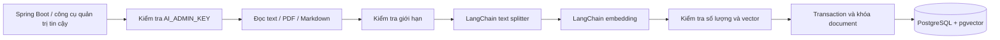
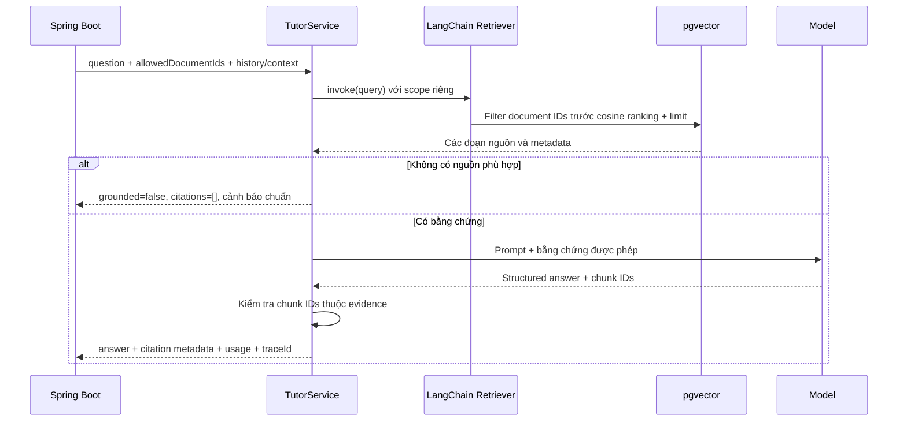

# RAG Tutor — Hai luồng nghiệp vụ với LangChain và pgvector

## Phạm vi và trạng thái

Triển khai ở `AI/`: thành phần Python nội bộ của kiến trúc modular monolith đã chốt.
Đây không phải chuyển đổi toàn hệ thống sang microservices. Spring Boot vẫn sở hữu auth,
RBAC, học liệu/phiên bản, hội thoại người dùng, quota và dữ liệu học tập.

Tham khảo: [LangChain RAG](https://docs.langchain.com/oss/python/deepagents/rag) và
[retrieval architectures](https://docs.langchain.com/oss/python/langchain/retrieval).
Chọn retrieve-then-generate (2-step) với kiểm tra citation. Không thêm Deep Agents,
filesystem offloading hoặc subagents: các cơ chế đó phù hợp bài nghiên cứu nhiều bước,
chưa cần cho luồng TOEIC có scope/latency xác định. LangChain được dùng thực tế qua
Document, RecursiveCharacterTextSplitter, BaseRetriever.invoke, Gemini embeddings và
structured-output Runnable. Repository pgvector tùy chỉnh giữ predicate quyền trong SQL.

Hai luồng nội bộ đã có API/service/persistence/test. API hội thoại public, frontend chat,
quota người dùng, dashboard usage và đồng bộ publish tự động chưa được nối vào Spring Boot;
không coi thành phần AI nội bộ là đã hoàn tất toàn bộ UC-11 của sản phẩm web.

## Cấu trúc và trách nhiệm

| Thành phần | Trách nhiệm |
|---|---|
| knowledge/router.py | API quản trị học liệu, chỉ chấp nhận khóa admin nội bộ |
| knowledge/loaders.py | Đọc PDF có text/TXT/Markdown, kiểm tra giới hạn và encoding |
| KnowledgeService | Kiểm tra title/text, chia đoạn, embedding và yêu cầu thay index nguyên tử |
| RetrievalService | Tạo LangChain retriever mới cho mỗi request, không chia sẻ scope mutable |
| AuthorizedPgvectorRetriever | Kiểm tra scope, embedding query, tìm các đoạn được phép |
| TutorService | Xây prompt có bằng chứng, gọi model, đối chiếu citation và tạo fallback |
| infrastructure/vector_store.py | Transaction, pgvector cosine search, khóa ghi theo documentId |
| infrastructure/migrations.py | Cấu hình Alembic, kiểm tra revision và vector-space signature |
| migrations/env.py và versions/ | Chạy revision trong transaction, khóa deploy và tiếp nhận schema cũ |
| shared/security.py | Tách khóa ingestion/query; so sánh khóa constant-time |
| providers.py | Adapter LangChain Gemini, timeout và structured output |
| main.py | Composition root; khởi tạo, đóng tài nguyên, trace ID và lỗi đã lọc |

Không còn facade `app/service.py` hoặc compatibility import `app/store.py`.
Router và test dùng trực tiếp service/repository theo trách nhiệm nghiệp vụ.

## Luồng 1 — Knowledge ingestion

- `PUT /internal/v1/documents`: JSON documentId/title/text/sourceUrl.
- `POST /internal/v1/documents/upload`: multipart documentId/title/file.
- `GET /internal/v1/documents`: limit mặc định 50, 1–100; offset >= 0.
- `DELETE /internal/v1/documents/{documentId}`: xóa index, không xóa học liệu nghiệp vụ.
- Mọi endpoint yêu cầu `X-API-Key: AI_ADMIN_KEY`; service key không được dùng thay.
- Chỉ chấp nhận PDF có text, TXT/MD UTF-8; PDF scan cần OCR bên ngoài.
- Không fetch sourceUrl; đó chỉ là metadata nguồn.
- Embedding hoàn thành trước transaction, lỗi model/ghi DB không làm mất index cũ.
- Chunk ID được tạo từ documentId, vị trí và hash nội dung.
- PUT cùng documentId là thao tác thay index; commit sau cùng thắng. Publish/archive cùng
  version cần được backend serialize, không suy đoán thứ tự theo lúc bắt đầu request HTTP.

## Luồng 2 — Tutor querying

- `POST /internal/v1/search`: query, allowedDocumentIds, topK.
- `POST /internal/v1/tutor/ask`: question, allowedDocumentIds, mode, language, history, context.
- Yêu cầu `AI_SERVICE_KEY`; không chấp nhận admin key thay cho service key.
- allowedDocumentIds bắt buộc; rỗng/không có tài liệu thì fallback trước khi gọi embedding/LLM.
- Scope phải do backend tính, không nhận trực tiếp từ browser.
- history tối đa 12 message là ngữ cảnh, không phải bằng chứng; context phải được backend kiểm quyền.
- Citation chỉ lấy metadata từ DB, không tin title/URL do model tạo.
- ID nguồn giả/ngoài scope: 502 AI_INVALID_RESPONSE, không trả nội dung model ra ngoài.
- Thiếu nguồn hoặc model báo không đủ bằng chứng: 200, grounded=false, citations/exercises rỗng,
  warning chính xác **Không tìm thấy tài liệu tham khảo trong hệ thống.**
- grounded=true xác minh ID nguồn, không chứng minh mọi phát biểu đều đúng ngữ nghĩa.
- Lỗi provider/index: 503; các module học/thi/SRS không phụ thuộc service này để hoạt động.
- Không ghi câu hỏi, câu trả lời, key hoặc chi tiết lỗi provider vào access log.

## pgvector và migration

Runtime bắt buộc PostgreSQL + pgvector, không fallback SQLite. SQLite chỉ là test double
được opt-in trong fixture, không đủ để tuyên bố kiểm thử PostgreSQL đạt.

`python -m alembic upgrade head` chạy revision trong transaction dưới advisory lock.
Alembic lưu revision trong `rag_alembic_version`, không dùng bảng version của backend.
Không sửa migration đã áp dụng; thay schema bằng revision mới. API chỉ kiểm tra revision,
schema và embedding/chunk signature, không tự CREATE TABLE/EXTENSION khi startup.
Tài khoản migration cần quyền tạo extension hoặc extension được DBA tạo sẵn; runtime chỉ
cần đọc/ghi dữ liệu index và đọc migration metadata.

Revision `0001_rag_index` tạo index mới hoặc tiếp nhận index cũ sau khi kiểm tra checksum SQL,
cấu trúc cột/nullable/PK/FK, signature và số chiều vector. SQL `001_pgvector_index.sql` đã áp dụng
được giữ nguyên làm lịch sử, không chạy lại khi tiếp nhận. Bảng `rag_schema_migrations` cũ cũng
giữ nguyên. Schema khác/lịch sử không đúng bị từ chối trong transaction, không stamp mù.
Baseline không downgrade để bảo toàn dữ liệu. Tạo revision mới bằng `alembic revision -m ...`
và viết upgrade/downgrade; autogenerate/offline SQL chưa được hỗ trợ.

Các bảng `rag_*` là index dẫn xuất riêng. V7 đang dùng REAL[] trong knowledge_chunks;
ERD minh họa vector(768). Quyết định hiện tại không sửa V7/V10 và không để Python ghi vào
knowledge_documents/knowledge_chunks nghiệp vụ. Khi tích hợp, Spring Boot phải lưu mapping
documentId/index chunk → đúng content version/source; không gán chunk ID Python trực tiếp
vào FK ai_message_sources nếu chưa có bản ghi tương ứng. Mapping/schema nghiệp vụ bổ sung
cần migration backend mới.

Cosine search là exact search trong scope. Chưa có ANN index; cần đo recall/latency trên corpus
thực trước khi thêm HNSW vì lọc quyền phải giữ đúng semantics. Embedding dimension/model/chunk
signature đổi thì dùng index mới và nạp lại, không trộn vector-space.

## Contract tích hợp Spring Boot

1. Xác thực session hiện hành, permission và chủ hội thoại; kiểm tra quota/rate limit.
2. Tính tập content version published được phép theo chính sách học liệu hiện hành.
3. Gửi documentId của đúng version, lịch sử đã lưu và context được phép qua internal HTTP.
4. Lưu messageId nghiệp vụ, câu trả lời, citation snapshot và usage; không giữ DB transaction
   mở khi chờ embedding/LLM.
5. Khi thu hồi quyền/archive, bỏ nguồn khỏi scope ngay; xóa index có thể làm sau.
6. Giữ lịch sử citation theo version/snapshot; không dựa vào chunk đã xóa khỏi index để render lịch sử.

API internal không thay public API /api/v1/ai/conversations trong API Specification.
Các chế độ grammar/vocabulary/explain_answer/reading/practice là khả năng sẵn có; practice
chỉ tạo nháp, không tự ghi ngân hàng câu hỏi/chấm thi/cập nhật SRS. Provider/model hiện dùng
Gemini theo code local; chưa đóng các mục OPEN khác như bảng giá, quota, retention hay idempotency.

## Kiểm thử và vận hành

- pytest mặc định: fixture SQLite + provider giả, không gọi mạng hoặc tiêu quota Gemini.
- TEST_POSTGRES_URL: database test riêng có pgvector; mỗi test tạo/xóa schema UUID của mình.
- Test PostgreSQL: Alembic upgrade lặp lại, tạo mới/tiếp nhận schema cũ không mất vector,
  từ chối legacy checksum/schema sai, vector-space mismatch, ACL trước ranking,
  hai luồng HTTP, concurrent replace cùng documentId.
- scripts/verify_rag.py --live: gọi Gemini thật, cần key và quota; kiểm tra pipeline và ID nguồn,
  không thay đánh giá ngữ nghĩa bởi người dùng.
- /health là liveness; /ready kiểm tra DB và có key, không khẳng định provider đang kết nối được.
- Backup/restore index, đánh giá chất lượng corpus và tối ưu tải lớn vẫn cần quy trình vận hành.
