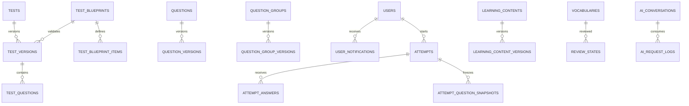

# TOEIC Learning Platform — ERD & Database Design v1.3

> **Trạng thái:** Thiết kế logic đề xuất, chưa Database Freeze. Bản này tích hợp 13 mục Design Review; DBML đi kèm là nguồn sơ đồ. Chưa kiểm chứng migration PostgreSQL.

## 1. Phạm vi, nguồn và nguyên tắc

- Nguồn: ERD v1.2 Reviewed, SRS v1.1, SAD v1.0 và Design Review 13 mục.
- PostgreSQL làm nguồn sự thật; pgvector lưu embeddings. Không sử dụng ChromaDB/Neo4j ở MVP.
- PK UUID cho bản ghi nghiệp vụ; FK bắt buộc nếu quan hệ bắt buộc; timestamp chuẩn hóa UTC/timestamptz khi triển khai.
- **Phân biệt:** cột/quan hệ trong DBML là thiết kế logic; CHECK, trigger, isolation, permissions, immutability phải kiểm chứng ở SQL.

## 2. Domain và quan hệ tổng quan

## 3. Danh mục bảng và từ điển dữ liệu

**Tổng số bảng trong DBML v1.3:** 64.

| Bảng | Số trường (xấp xỉ) | Khóa chính / vai trò |
|---|---:|---|
| `users` | 10 | `user_id` |
| `roles` | 3 | `role_id` |
| `permissions` | 3 | `permission_id` |
| `user_roles` | 3 | Composite key / xem indexes |
| `role_permissions` | 2 | Composite key / xem indexes |
| `content_categories` | 4 | `category_id` |
| `learning_contents` | 12 | `content_id` |
| `media_resources` | 8 | `resource_id` |
| `content_resources` | 2 | Composite key / xem indexes |
| `learning_progress` | 9 | `progress_id` |
| `bookmarks` | 3 | Composite key / xem indexes |
| `toeic_parts` | 4 | `part_id` |
| `topics` | 3 | `topic_id` |
| `question_types` | 4 | `question_type_id` |
| `question_groups` | 4 | `group_id` |
| `questions` | 9 | `question_id` |
| `question_versions` | 14 | `question_version_id` |
| `question_choices` | 6 | `choice_id` |
| `question_resources` | 2 | Composite key / xem indexes |
| `tests` | 8 | `test_id` |
| `test_versions` | 11 | `test_version_id` |
| `test_questions` | 5 | Composite key / xem indexes |
| `attempts` | 20 | `attempt_id` |
| `attempt_answers` | 7 | `attempt_answer_id` |
| `attempt_part_results` | 6 | `attempt_part_result_id` |
| `vocabulary_decks` | 6 | `deck_id` |
| `vocabularies` | 11 | `vocabulary_id` |
| `deck_vocabularies` | 3 | Composite key / xem indexes |
| `review_states` | 8 | `review_state_id` |
| `review_history` | 6 | `review_history_id` |
| `learning_profiles` | 7 | `profile_id` |
| `part_performance` | 8 | `performance_id` |
| `recommendations` | 9 | `recommendation_id` |
| `ai_conversations` | 5 | `conversation_id` |
| `ai_messages` | 5 | `message_id` |
| `knowledge_documents` | 8 | `document_id` |
| `knowledge_chunks` | 8 | `chunk_id` |
| `ai_message_sources` | 3 | Composite key / xem indexes |
| `ai_configs` | 6 | `config_id` |
| `dictation_exercises` | 10 | `dictation_id` |
| `dictation_attempts` | 8 | `attempt_id` |
| `dictation_answers` | 5 | `answer_id` |
| `shadowing_exercises` | 10 | `shadowing_id` |
| `shadowing_attempts` | 11 | `attempt_id` |
| `shadowing_feedback` | 5 | `feedback_id` |
| `question_group_versions` | 6 | `group_version_id` |
| `question_group_version_resources` | 3 | Composite key / xem indexes |
| `attempt_question_snapshots` | 7 | `snapshot_id` |
| `score_conversion_tables` | 6 | `score_conversion_table_id` |
| `score_conversion_rules` | 5 | `rule_id` |
| `audit_logs` | 7 | `audit_id` |
| `system_settings` | 4 | `setting_key` |
| `learning_content_versions` | 12 | `content_version_id` |
| `tags` | 5 | `tag_id` |
| `question_tags` | 3 | Composite key / xem indexes |
| `test_blueprints` | 9 | `blueprint_id` |
| `test_blueprint_items` | 5 | `blueprint_item_id` |
| `ai_request_logs` | 14 | `request_id` |
| `notifications` | 6 | `notification_id` |
| `user_notifications` | 7 | `user_notification_id` |
| `error_categories` | 6 | `error_category_id` |
| `question_error_categories` | 2 | Composite key / xem indexes |
| `user_error_statistics` | 5 | Composite key / xem indexes |
| `outbox_events` | 9 | `event_id` |

## 4. Data Dictionary chi tiết theo từng bảng

Ký hiệu: `PK` khóa chính; `FK` khóa ngoại; `UQ` duy nhất; `NN` không null. Những thuộc tính chưa được khai báo rõ trong DBML không được suy diễn là constraint SQL.

### `users`

| Trường | Kiểu / quy tắc |
|---|---|
| `user_id` | `uuid [pk]` |
| `email` | `varchar(255) [not null, unique]` |
| `password_hash` | `varchar(255) [not null]` |
| `full_name` | `varchar(150) [not null]` |
| `avatar_url` | `text` |
| `status` | `varchar(20) [not null]` |
| `email_verified_at` | `timestamp` |
| `last_login_at` | `timestamp` |
| `created_at` | `timestamp [not null]` |
| `updated_at` | `timestamp [not null]` |

### `roles`

| Trường | Kiểu / quy tắc |
|---|---|
| `role_id` | `integer [pk, increment]` |
| `name` | `varchar(50) [not null, unique]` |
| `description` | `text` |

### `permissions`

| Trường | Kiểu / quy tắc |
|---|---|
| `permission_id` | `integer [pk, increment]` |
| `code` | `varchar(100) [not null, unique]` |
| `description` | `text` |

### `user_roles`

| Trường | Kiểu / quy tắc |
|---|---|
| `user_id` | `uuid [not null, ref: > users.user_id]` |
| `role_id` | `integer [not null, ref: > roles.role_id]` |
| `assigned_at` | `timestamp` |

### `role_permissions`

| Trường | Kiểu / quy tắc |
|---|---|
| `role_id` | `integer [not null, ref: > roles.role_id]` |
| `permission_id` | `integer [not null, ref: > permissions.permission_id]` |

### `content_categories`

| Trường | Kiểu / quy tắc |
|---|---|
| `category_id` | `integer [pk, increment]` |
| `code` | `varchar(50) [not null, unique]` |
| `name` | `varchar(100) [not null]` |
| `description` | `text` |

### `learning_contents`

| Trường | Kiểu / quy tắc |
|---|---|
| `current_published_version_id` | `uuid` — optional pointer; set only after publish; FK in SQL |
| `content_id` | `uuid [pk]` |
| `category_id` | `integer [not null]` |
| `author_id` | `uuid [not null]` |
| `title` | `varchar(255) [not null]` |
| `summary` | `text` |
| `body` | `text` |
| `difficulty` | `varchar(20)` |
| `status` | `varchar(20) [not null]` |
| `published_at` | `timestamp` |
| `created_at` | `timestamp [not null]` |
| `updated_at` | `timestamp [not null]` |

### `media_resources`

| Trường | Kiểu / quy tắc |
|---|---|
| `resource_id` | `uuid [pk]` |
| `resource_type` | `varchar(30) [not null]` |
| `storage_url` | `text [not null]` |
| `mime_type` | `varchar(100)` |
| `file_size` | `bigint` |
| `duration_seconds` | `integer` |
| `transcript` | `text` |
| `created_at` | `timestamp [not null]` |

### `content_resources`

| Trường | Kiểu / quy tắc |
|---|---|
| `content_id` | `uuid [not null]` |
| `resource_id` | `uuid [not null]` |

### `learning_progress`

| Trường | Kiểu / quy tắc |
|---|---|
| `completed_content_version_id` | `uuid` — version seen when completed |
| `progress_id` | `uuid [pk]` |
| `user_id` | `uuid [not null]` |
| `content_id` | `uuid [not null]` |
| `status` | `varchar(20) [not null]` |
| `progress_percent` | `decimal(5,2)` |
| `started_at` | `timestamp` |
| `completed_at` | `timestamp` |
| `last_accessed_at` | `timestamp` |

### `bookmarks`

| Trường | Kiểu / quy tắc |
|---|---|
| `user_id` | `uuid [not null]` |
| `content_id` | `uuid [not null]` |
| `created_at` | `timestamp [not null]` |

### `toeic_parts`

| Trường | Kiểu / quy tắc |
|---|---|
| `part_id` | `integer [pk, increment]` |
| `part_number` | `integer [not null, unique]` |
| `skill` | `varchar(20) [not null]` |
| `name` | `varchar(100) [not null]` |

### `topics`

| Trường | Kiểu / quy tắc |
|---|---|
| `topic_id` | `integer [pk, increment]` |
| `name` | `varchar(100) [not null, unique]` |
| `description` | `text` |

### `question_types`

| Trường | Kiểu / quy tắc |
|---|---|
| `question_type_id` | `integer [pk, increment]` |
| `code` | `varchar(50) [not null, unique]` |
| `name` | `varchar(100) [not null]` |
| `description` | `text` |

### `question_groups`

| Trường | Kiểu / quy tắc |
|---|---|
| `group_id` | `uuid [pk]` |
| `group_type` | `varchar(30)` |
| `created_at` | `timestamp [not null]` |
| `updated_at` | `timestamp [not null]` |

### `questions`

| Trường | Kiểu / quy tắc |
|---|---|
| `question_id` | `uuid [pk]` |
| `group_id` | `uuid` |
| `part_id` | `integer [not null]` |
| `topic_id` | `integer` |
| `question_type_id` | `integer [not null]` |
| `created_by` | `uuid [not null]` |
| `status` | `varchar(20) [not null]` |
| `created_at` | `timestamp [not null]` |
| `updated_at` | `timestamp [not null]` |

### `question_versions`

| Trường | Kiểu / quy tắc |
|---|---|
| `reviewed_by` | `uuid` |
| `reviewed_at` | `timestamp` |
| `approved_by` | `uuid` |
| `approved_at` | `timestamp` |
| `published_at` | `timestamp` |
| `archived_at` | `timestamp` |
| `group_version_id` | `uuid` — nullable for standalone question; if present must belong to question.group_id |
| `question_version_id` | `uuid [pk]` |
| `question_id` | `uuid [not null]` |
| `version_number` | `integer [not null]` |
| `question_text` | `text [not null]` |
| `explanation` | `text` |
| `difficulty` | `varchar(20)` |
| `created_at` | `timestamp [not null]` |

### `question_choices`

| Trường | Kiểu / quy tắc |
|---|---|
| `choice_id` | `uuid [pk]` |
| `question_version_id` | `uuid [not null]` |
| `choice_label` | `varchar(10) [not null]` |
| `content` | `text [not null]` |
| `is_correct` | `boolean [not null]` |
| `display_order` | `integer [not null]` |

### `question_resources`

| Trường | Kiểu / quy tắc |
|---|---|
| `question_version_id` | `uuid [not null]` |
| `resource_id` | `uuid [not null]` |

### `tests`

| Trường | Kiểu / quy tắc |
|---|---|
| `test_id` | `uuid [pk]` |
| `created_by` | `uuid [not null]` |
| `title` | `varchar(255) [not null]` |
| `description` | `text` |
| `test_type` | `varchar(30) [not null]` |
| `status` | `varchar(20) [not null]` |
| `created_at` | `timestamp [not null]` |
| `updated_at` | `timestamp [not null]` |

### `test_versions`

| Trường | Kiểu / quy tắc |
|---|---|
| `blueprint_id` | `uuid` — frozen blueprint reference at publication |
| `retired_at` | `timestamp` |
| `max_attempts` | `integer` — NULL = unlimited; positive otherwise; version policy immutable after publish |
| `test_version_id` | `uuid [pk]` |
| `test_id` | `uuid [not null]` |
| `version_number` | `integer [not null]` |
| `duration_seconds` | `integer` |
| `total_questions` | `integer` |
| `status` | `varchar(20) [not null]` |
| `published_at` | `timestamp` |
| `created_at` | `timestamp [not null]` |

### `test_questions`

| Trường | Kiểu / quy tắc |
|---|---|
| `test_version_id` | `uuid [not null]` |
| `question_version_id` | `uuid [not null]` |
| `question_group_version_id` | `uuid` — frozen group; match question_versions.group_version_id |
| `question_order` | `integer [not null]` |
| `points` | `decimal(6,2)` |

### `attempts`

| Trường | Kiểu / quy tắc |
|---|---|
| `attempt_id` | `uuid [pk]` |
| `user_id` | `uuid [not null]` |
| `test_version_id` | `uuid` — required iff attempt_source_type = TEST_VERSION |
| `attempt_type` | `varchar(30) [not null]` |
| `attempt_source_type` | `varchar(30) [not null]` — TEST_VERSION / PRACTICE_SNAPSHOT; conditional FK presence CHECK |
| `expires_at` | `timestamp [not null]` — server authoritative; must be after started_at |
| `max_attempts_snapshot` | `integer` — frozen policy at start |
| `status` | `varchar(20) [not null]` |
| `started_at` | `timestamp [not null]` |
| `submitted_at` | `timestamp` |
| `duration_seconds` | `integer` |
| `total_questions` | `integer` |
| `correct_count` | `integer` |
| `listening_correct_count` | `integer` |
| `reading_correct_count` | `integer` |
| `listening_estimated_score` | `integer` |
| `reading_estimated_score` | `integer` |
| `total_estimated_score` | `integer` |
| `score_conversion_table_id` | `uuid` — nullable; frozen conversion version |
| `created_at` | `timestamp [not null]` |

### `attempt_answers`

| Trường | Kiểu / quy tắc |
|---|---|
| `attempt_answer_id` | `uuid [pk]` |
| `attempt_id` | `uuid [not null]` |
| `question_version_id` | `uuid [not null]` |
| `selected_choice_id` | `uuid` — nullable for unanswered; composite FK with question_version_id |
| `is_correct` | `boolean` |
| `answered_at` | `timestamp` |
| `updated_at` | `timestamp [not null]` |

### `attempt_part_results`

| Trường | Kiểu / quy tắc |
|---|---|
| `attempt_part_result_id` | `uuid [pk]` |
| `attempt_id` | `uuid [not null]` |
| `part_id` | `integer [not null]` |
| `total_questions` | `integer [not null]` |
| `correct_count` | `integer [not null]` |
| `accuracy` | `decimal(5,2)` |

### `vocabulary_decks`

| Trường | Kiểu / quy tắc |
|---|---|
| `deck_id` | `uuid [pk]` |
| `user_id` | `uuid [not null]` |
| `name` | `varchar(150) [not null]` |
| `description` | `text` |
| `created_at` | `timestamp [not null]` |
| `updated_at` | `timestamp [not null]` |

### `vocabularies`

| Trường | Kiểu / quy tắc |
|---|---|
| `part_of_speech` | `varchar(40)` — one lexical sense per vocabulary entry |
| `pronunciation_audio_resource_id` | `uuid` |
| `vocabulary_id` | `uuid [pk]` |
| `created_by` | `uuid [not null]` |
| `word` | `varchar(150) [not null]` |
| `meaning` | `text [not null]` |
| `pronunciation` | `varchar(255)` |
| `example` | `text` |
| `note` | `text` |
| `created_at` | `timestamp [not null]` |
| `updated_at` | `timestamp [not null]` |

### `deck_vocabularies`

| Trường | Kiểu / quy tắc |
|---|---|
| `deck_id` | `uuid [not null]` |
| `vocabulary_id` | `uuid [not null]` |
| `added_at` | `timestamp [not null]` |

### `review_states`

| Trường | Kiểu / quy tắc |
|---|---|
| `review_state_id` | `uuid [pk]` |
| `user_id` | `uuid [not null]` |
| `vocabulary_id` | `uuid [not null]` |
| `repetition_count` | `integer [not null]` |
| `interval_days` | `integer [not null]` |
| `ease_factor` | `decimal(4,2)` |
| `last_reviewed_at` | `timestamp` |
| `next_review_at` | `timestamp [not null]` |

### `review_history`

| Trường | Kiểu / quy tắc |
|---|---|
| `review_history_id` | `uuid [pk]` |
| `review_state_id` | `uuid [not null]` |
| `rating` | `integer [not null]` — 1 Again, 2 Hard, 3 Good, 4 Easy; CHECK 1..4 |
| `previous_interval` | `integer` |
| `new_interval` | `integer` |
| `reviewed_at` | `timestamp [not null]` |

### `learning_profiles`

| Trường | Kiểu / quy tắc |
|---|---|
| `profile_id` | `uuid [pk]` |
| `user_id` | `uuid [not null, unique]` |
| `target_score` | `integer` |
| `estimated_score` | `integer` — estimated only; never official ETS score |
| `listening_level` | `varchar(30)` |
| `reading_level` | `varchar(30)` |
| `updated_at` | `timestamp [not null]` |

### `part_performance`

| Trường | Kiểu / quy tắc |
|---|---|
| `performance_id` | `uuid [pk]` |
| `user_id` | `uuid [not null]` |
| `part_id` | `integer [not null]` |
| `attempted_questions` | `integer [not null]` |
| `correct_questions` | `integer [not null]` |
| `accuracy` | `decimal(5,2)` |
| `mastery_score` | `decimal(5,2)` |
| `updated_at` | `timestamp [not null]` |

### `recommendations`

| Trường | Kiểu / quy tắc |
|---|---|
| `recommendation_id` | `uuid [pk]` |
| `user_id` | `uuid [not null]` |
| `recommendation_type` | `varchar(50) [not null]` |
| `title` | `varchar(255) [not null]` |
| `description` | `text` |
| `source` | `varchar(50)` |
| `priority` | `integer` |
| `generated_at` | `timestamp [not null]` |
| `expires_at` | `timestamp` |

### `ai_conversations`

| Trường | Kiểu / quy tắc |
|---|---|
| `conversation_id` | `uuid [pk]` |
| `user_id` | `uuid [not null]` |
| `title` | `varchar(255)` |
| `created_at` | `timestamp [not null]` |
| `updated_at` | `timestamp [not null]` |

### `ai_messages`

| Trường | Kiểu / quy tắc |
|---|---|
| `message_id` | `uuid [pk]` |
| `conversation_id` | `uuid [not null]` |
| `role` | `varchar(20) [not null]` |
| `content` | `text [not null]` |
| `created_at` | `timestamp [not null]` |

### `knowledge_documents`

| Trường | Kiểu / quy tắc |
|---|---|
| `learning_content_version_id` | `uuid` — optional immutable source version |
| `document_id` | `uuid [pk]` |
| `title` | `varchar(255) [not null]` |
| `source_type` | `varchar(50)` |
| `source_url` | `text` |
| `status` | `varchar(20) [not null]` |
| `created_at` | `timestamp [not null]` |
| `updated_at` | `timestamp [not null]` |

### `knowledge_chunks`

| Trường | Kiểu / quy tắc |
|---|---|
| `learning_content_version_id` | `uuid` — optional source-version traceability |
| `chunk_id` | `uuid [pk]` |
| `document_id` | `uuid [not null]` |
| `chunk_index` | `integer [not null]` |
| `content` | `text [not null]` |
| `embedding` | `vector(768)` — EXAMPLE dimension; align with selected model |
| `embedding_model` | `varchar(120)` |
| `created_at` | `timestamp [not null]` |

### `ai_message_sources`

| Trường | Kiểu / quy tắc |
|---|---|
| `message_id` | `uuid [not null]` |
| `chunk_id` | `uuid [not null]` |
| `relevance_score` | `decimal(6,5)` |

### `ai_configs`

| Trường | Kiểu / quy tắc |
|---|---|
| `config_id` | `uuid [pk]` |
| `config_key` | `varchar(100) [not null, unique]` |
| `config_value` | `text [not null]` |
| `description` | `text` |
| `updated_by` | `uuid` |
| `updated_at` | `timestamp [not null]` |

### `dictation_exercises`

| Trường | Kiểu / quy tắc |
|---|---|
| `dictation_id` | `uuid [pk]` |
| `title` | `varchar(255) [not null]` |
| `instruction` | `text` |
| `audio_resource_id` | `uuid [not null]` |
| `transcript` | `text [not null]` |
| `difficulty` | `varchar(20)` |
| `status` | `varchar(20) [not null]` |
| `created_by` | `uuid [not null]` |
| `created_at` | `timestamp [not null]` |
| `updated_at` | `timestamp [not null]` |

### `dictation_attempts`

| Trường | Kiểu / quy tắc |
|---|---|
| `attempt_id` | `uuid [pk]` |
| `dictation_id` | `uuid [not null]` |
| `user_id` | `uuid [not null]` |
| `status` | `varchar(20) [not null]` |
| `score` | `decimal(5,2)` |
| `started_at` | `timestamp [not null]` |
| `completed_at` | `timestamp` |
| `created_at` | `timestamp [not null]` |

### `dictation_answers`

| Trường | Kiểu / quy tắc |
|---|---|
| `answer_id` | `uuid [pk]` |
| `attempt_id` | `uuid [not null]` |
| `user_text` | `text [not null]` |
| `accuracy` | `decimal(5,2)` |
| `submitted_at` | `timestamp [not null]` |

### `shadowing_exercises`

| Trường | Kiểu / quy tắc |
|---|---|
| `shadowing_id` | `uuid [pk]` |
| `title` | `varchar(255) [not null]` |
| `instruction` | `text` |
| `audio_resource_id` | `uuid [not null]` |
| `transcript` | `text [not null]` |
| `difficulty` | `varchar(20)` |
| `status` | `varchar(20) [not null]` |
| `created_by` | `uuid [not null]` |
| `created_at` | `timestamp [not null]` |
| `updated_at` | `timestamp [not null]` |

### `shadowing_attempts`

| Trường | Kiểu / quy tắc |
|---|---|
| `attempt_id` | `uuid [pk]` |
| `shadowing_id` | `uuid [not null]` |
| `user_id` | `uuid [not null]` |
| `recording_resource_id` | `uuid` |
| `status` | `varchar(20) [not null]` |
| `pronunciation_score` | `decimal(5,2)` |
| `fluency_score` | `decimal(5,2)` |
| `overall_score` | `decimal(5,2)` |
| `started_at` | `timestamp [not null]` |
| `completed_at` | `timestamp` |
| `created_at` | `timestamp [not null]` |

### `shadowing_feedback`

| Trường | Kiểu / quy tắc |
|---|---|
| `feedback_id` | `uuid [pk]` |
| `attempt_id` | `uuid [not null]` |
| `feedback_type` | `varchar(30)` |
| `feedback_text` | `text [not null]` |
| `created_at` | `timestamp [not null]` |

### `question_group_versions`

| Trường | Kiểu / quy tắc |
|---|---|
| `group_version_id` | `uuid [pk]` |
| `group_id` | `uuid [not null]` |
| `version_number` | `integer [not null]` |
| `instruction` | `text` |
| `passage_text` | `text` |
| `created_at` | `timestamp [not null]` |

### `question_group_version_resources`

| Trường | Kiểu / quy tắc |
|---|---|
| `group_version_id` | `uuid [not null]` |
| `resource_id` | `uuid [not null]` |
| `display_order` | `integer [not null, default: 1]` |

### `attempt_question_snapshots`

| Trường | Kiểu / quy tắc |
|---|---|
| `snapshot_id` | `uuid [pk]` |
| `attempt_id` | `uuid [not null]` |
| `question_version_id` | `uuid [not null]` |
| `question_group_version_id` | `uuid` — frozen group; must match question version if non-null |
| `question_order` | `integer [not null]` |
| `points` | `decimal(6,2)` |
| `created_at` | `timestamp [not null]` |

### `score_conversion_tables`

| Trường | Kiểu / quy tắc |
|---|---|
| `score_conversion_table_id` | `uuid [pk]` |
| `name` | `varchar(150) [not null]` |
| `version_number` | `integer [not null]` |
| `status` | `varchar(20) [not null]` — DRAFT / ACTIVE / RETIRED; ACTIVE/RETIRED rule rows immutable |
| `activated_at` | `timestamp` |
| `created_at` | `timestamp [not null]` |

### `score_conversion_rules`

| Trường | Kiểu / quy tắc |
|---|---|
| `rule_id` | `uuid [pk]` |
| `score_conversion_table_id` | `uuid [not null]` |
| `skill` | `varchar(20) [not null]` — LISTENING / READING |
| `correct_count` | `integer [not null]` |
| `estimated_score` | `integer [not null]` — CHECK 5..495, step 5; raw correct CHECK 0..100 |

### `audit_logs`

| Trường | Kiểu / quy tắc |
|---|---|
| `audit_id` | `uuid [pk]` |
| `actor_user_id` | `uuid` |
| `action` | `varchar(100) [not null]` |
| `entity_type` | `varchar(100) [not null]` |
| `entity_id` | `uuid` |
| `details` | `jsonb` |
| `created_at` | `timestamp [not null]` |

### `system_settings`

| Trường | Kiểu / quy tắc |
|---|---|
| `setting_key` | `varchar(100) [pk]` |
| `setting_value` | `jsonb [not null]` |
| `updated_by` | `uuid` |
| `updated_at` | `timestamp [not null]` |

### `learning_content_versions`

| Trường | Kiểu / quy tắc |
|---|---|
| `content_version_id` | `uuid [pk]` |
| `content_id` | `uuid [not null, ref: > learning_contents.content_id]` |
| `version_number` | `integer [not null]` |
| `title` | `varchar(255) [not null]` |
| `summary` | `text` |
| `body` | `text [not null]` |
| `status` | `varchar(20) [not null]` — DRAFT / PUBLISHED / ARCHIVED |
| `published_at` | `timestamp` |
| `archived_at` | `timestamp` |
| `created_by` | `uuid [not null, ref: > users.user_id]` |
| `created_at` | `timestamp [not null]` |
| `updated_at` | `timestamp [not null]` |

### `tags`

| Trường | Kiểu / quy tắc |
|---|---|
| `tag_id` | `uuid [pk]` |
| `code` | `varchar(80) [not null, unique]` |
| `name` | `varchar(120) [not null]` |
| `created_at` | `timestamp [not null]` |
| `updated_at` | `timestamp [not null]` |

### `question_tags`

| Trường | Kiểu / quy tắc |
|---|---|
| `question_id` | `uuid [not null, ref: > questions.question_id]` |
| `tag_id` | `uuid [not null, ref: > tags.tag_id]` |
| `created_at` | `timestamp [not null]` |

### `test_blueprints`

| Trường | Kiểu / quy tắc |
|---|---|
| `blueprint_id` | `uuid [pk]` |
| `code` | `varchar(80) [not null]` |
| `version_number` | `integer [not null]` |
| `name` | `varchar(150) [not null]` |
| `blueprint_type` | `varchar(30) [not null]` — FULL_MOCK / SECTION / PRACTICE |
| `status` | `varchar(20) [not null]` — DRAFT / ACTIVE / RETIRED |
| `expected_total_questions` | `integer [not null]` |
| `created_at` | `timestamp [not null]` |
| `updated_at` | `timestamp [not null]` |

### `test_blueprint_items`

| Trường | Kiểu / quy tắc |
|---|---|
| `blueprint_item_id` | `uuid [pk]` |
| `blueprint_id` | `uuid [not null, ref: > test_blueprints.blueprint_id]` |
| `part_id` | `integer [not null, ref: > toeic_parts.part_id]` |
| `expected_question_count` | `integer [not null]` |
| `expected_group_count` | `integer` — nullable if not applicable |

### `ai_request_logs`

| Trường | Kiểu / quy tắc |
|---|---|
| `request_id` | `uuid [pk]` |
| `conversation_id` | `uuid [ref: > ai_conversations.conversation_id]` |
| `user_id` | `uuid [ref: > users.user_id]` |
| `provider` | `varchar(100) [not null]` |
| `model` | `varchar(150) [not null]` |
| `prompt_tokens` | `integer` |
| `completion_tokens` | `integer` |
| `total_tokens` | `integer` |
| `latency_ms` | `integer` |
| `estimated_cost` | `decimal(16,8)` |
| `cost_currency` | `varchar(3)` — ISO 4217, e.g. USD |
| `status` | `varchar(30) [not null]` — SUCCESS / ERROR / TIMEOUT / REJECTED |
| `error_code` | `varchar(100)` |
| `created_at` | `timestamp [not null]` |

### `notifications`

| Trường | Kiểu / quy tắc |
|---|---|
| `notification_id` | `uuid [pk]` |
| `notification_type` | `varchar(60) [not null]` |
| `title` | `varchar(255) [not null]` |
| `body` | `text [not null]` |
| `payload_json` | `jsonb` |
| `created_at` | `timestamp [not null]` |

### `user_notifications`

| Trường | Kiểu / quy tắc |
|---|---|
| `user_notification_id` | `uuid [pk]` |
| `notification_id` | `uuid [not null, ref: > notifications.notification_id]` |
| `user_id` | `uuid [not null, ref: > users.user_id]` |
| `delivery_status` | `varchar(20) [not null]` — PENDING / DELIVERED / FAILED |
| `delivered_at` | `timestamp` |
| `read_at` | `timestamp` |
| `created_at` | `timestamp [not null]` |

### `error_categories`

| Trường | Kiểu / quy tắc |
|---|---|
| `error_category_id` | `uuid [pk]` |
| `code` | `varchar(80) [not null, unique]` |
| `name` | `varchar(150) [not null]` |
| `description` | `text` |
| `created_at` | `timestamp [not null]` |
| `updated_at` | `timestamp [not null]` |

### `question_error_categories`

| Trường | Kiểu / quy tắc |
|---|---|
| `question_id` | `uuid [not null, ref: > questions.question_id]` |
| `error_category_id` | `uuid [not null, ref: > error_categories.error_category_id]` |

### `user_error_statistics`

| Trường | Kiểu / quy tắc |
|---|---|
| `user_id` | `uuid [not null, ref: > users.user_id]` |
| `error_category_id` | `uuid [not null, ref: > error_categories.error_category_id]` |
| `attempted_count` | `integer [not null]` |
| `incorrect_count` | `integer [not null]` |
| `updated_at` | `timestamp [not null]` |

### `outbox_events`

| Trường | Kiểu / quy tắc |
|---|---|
| `event_id` | `uuid [pk]` |
| `event_type` | `varchar(100) [not null]` |
| `aggregate_type` | `varchar(80) [not null]` |
| `aggregate_id` | `uuid [not null]` |
| `payload_json` | `jsonb [not null]` |
| `status` | `varchar(20) [not null]` — PENDING / PROCESSED / FAILED |
| `occurred_at` | `timestamp [not null]` |
| `processed_at` | `timestamp` |
| `retry_count` | `integer [not null]` |

## 5. State machines và bất biến

### 5.1 QuestionVersion

`DRAFT → IN_REVIEW → APPROVED → PUBLISHED → ARCHIVED`; có thể trả `IN_REVIEW → DRAFT` khi yêu cầu sửa; `APPROVED → DRAFT` khi thu hồi duyệt. Chỉ người có quyền review/approve/publish mới chuyển tương ứng. Không sửa nội dung phiên bản đã `PUBLISHED`; tạo version mới. Archive không xóa lịch sử.

### 5.2 TestVersion

`DRAFT → PUBLISHED → RETIRED`. Khi publish, chốt `test_questions`, question/group versions, duration, blueprint và max_attempts. Attempt đã tạo tiếp tục dùng version cũ ngay cả khi test bị retired.

### 5.3 LearningContentVersion

`DRAFT → PUBLISHED → ARCHIVED`. `learning_contents` là identity và metadata của nội dung; learner và RAG citation phải tham chiếu `learning_content_versions` cụ thể. Không chỉnh sửa bản đã published; tạo version mới.

### 5.4 Attempt

`CREATED → IN_PROGRESS → SUBMITTED → GRADED`. Expiry tự submit theo `expires_at` từ server; mất kết nối giữ `IN_PROGRESS` cho đến khi hết hạn. Submit/grading idempotent; dữ liệu câu hỏi, đáp án chuẩn, bảng quy đổi phải được đóng băng.

## 6. Các ràng buộc nghiệp vụ bắt buộc ở SQL/application

| ID | Quy tắc | Cách kiểm chứng |
|---|---|---|
| DB-01 | `attempt_source_type=TEST_VERSION` đòi `test_version_id IS NOT NULL`; practice snapshot không gắn test version | CHECK |
| DB-02 | `expires_at > started_at` | CHECK |
| DB-03 | `max_attempts IS NULL OR max_attempts > 0` | CHECK |
| DB-04 | `0 <= correct_count <= total_questions` | CHECK |
| DB-05 | `rating IN (1,2,3,4)` | CHECK |
| DB-06 | `0 <= progress_percent <= 100`, `0 <= accuracy <= 100` | CHECK |
| DB-07 | `selected_choice_id` thuộc đúng `question_version_id` | Composite FK hoặc trigger |
| DB-08 | Câu trả lời phải thuộc tập snapshot/đề của Attempt | Transaction validation + constraint |
| DB-09 | Không sửa nội dung published | Trigger, permissions, service policy |
| DB-10 | `question_group_version_id` khớp group version của question version | Publish validation |
| DB-11 | Bảng quy đổi đã dùng không được thay đổi quy tắc | Versioning + permissions |
| DB-12 | Blueprint kiểm tra số câu, số nhóm và thứ tự Part | Publish validator |
| DB-13 | AI logs không lưu prompt nhạy cảm mặc định; token/cost không âm | CHECK + privacy policy |
| DB-14 | User notifications chỉ thuộc đúng user, read_at không trước created_at | FK + CHECK |
| DB-15 | Start/submit/autosave đồng thời không vượt giới hạn và không ghi sau submit | Locking/optimistic version |
| DB-16 | Media đã được published tham chiếu không được hard-delete | RESTRICT / soft-delete |
| DB-17 | `review_states` duy nhất theo `(user_id,vocabulary_id)` | UNIQUE |
| DB-18 | Mỗi bảng master có created_at/updated_at; transaction có created_at/event time | Schema audit |

## 7. Blueprint TOEIC — ví dụ chuẩn 200 câu

| Part | Số câu | Ghi chú |
|---|---:|---|
| 1 | 6 | Listening |
| 2 | 25 | Listening |
| 3 | 39 | Nhóm conversation/audio |
| 4 | 30 | Nhóm talk/audio |
| 5 | 30 | Reading |
| 6 | 16 | Nhóm text |
| 7 | 54 | Nhóm passages |
| **Tổng** | **200** | Full Mock blueprint; không áp dụng bắt buộc cho Section/Dynamic Practice |

Blueprint cần versioning và không được thay đổi khi đã được test published tham chiếu. `expected_group_count` chỉ bắt buộc với các Part áp dụng nhóm, và phải được kiểm tra theo cấu trúc nội dung thực tế.

## 8. Enum và timestamp conventions

- QuestionVersionStatus: `DRAFT`, `IN_REVIEW`, `APPROVED`, `PUBLISHED`, `ARCHIVED`.
- TestVersionStatus: `DRAFT`, `PUBLISHED`, `RETIRED`.
- LearningContentVersionStatus: `DRAFT`, `PUBLISHED`, `ARCHIVED`.
- AttemptStatus: `CREATED`, `IN_PROGRESS`, `SUBMITTED`, `GRADED`.
- AttemptSourceType: `TEST_VERSION`, `PRACTICE_SNAPSHOT`.
- ReviewRating: `AGAIN=1`, `HARD=2`, `GOOD=3`, `EASY=4`.
- Difficulty, Skill, AttemptType: danh mục kiểm soát; cần chốt mã hợp lệ trước migration, không để VARCHAR tự do.
- `created_at`, `updated_at`, `published_at`, `submitted_at`, `reviewed_at`, `occurred_at`: lưu theo UTC; triển khai PostgreSQL ưu tiên `timestamptz`.

## 9. Indexes, bảo mật và vận hành

- Index FK và filter thường dùng: `(user_id,status,created_at)` attempts, `(user_id,next_review_at)` review_states, `(test_version_id,question_order)` test_questions, `(status,created_at)` outbox_events.
- Ràng buộc uniqueness theo phiên bản: `(test_id,version_number)`, `(content_id,version_number)`, `(group_id,version_number)`.
- Token, password hash và secrets không lưu trong audit logs. Phân quyền theo service và user; AI chỉ truy xuất knowledge được cấp quyền.
- pgvector dimension phải khớp embedding model, hiện `vector(768)` chỉ là giả định thiết kế.
- AI usage cost là ước tính theo pricing version, không đồng nhất với hóa đơn provider.

## 10. Các quyết định chưa khóa / điều kiện Database Freeze

1. Xác nhận state machine transition matrix, quyền review/publish và cơ chế audit.
2. Chốt quy tắc tag ở Question identity hay QuestionVersion; thiết kế hiện tại gắn Question, phù hợp taxonomy ổn định nhưng tag có thể thay đổi qua thời gian.
3. Chốt versioning của media/transcript và câu trích dẫn AI.
4. Chốt blueprint nhóm Part 3/4/6/7, grading snapshot, composite FK và snapshot storage.
5. Sinh DDL PostgreSQL; chạy migration lên database rỗng; thử PK/FK/CHECK, concurrency và data-integrity tests.
6. Kiểm chứng import DBML và rà soát tất cả ref/column/index.

**Không tuyên bố Database Frozen trước khi hoàn tất checklist này.**
