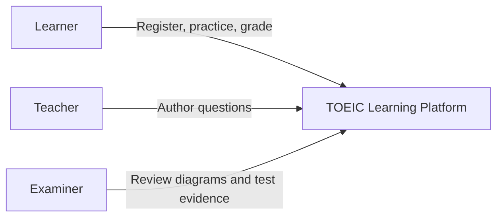
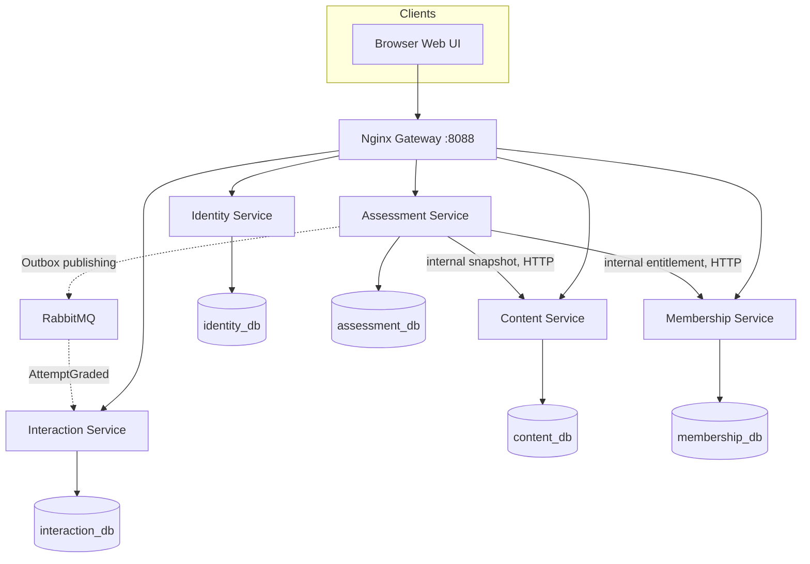
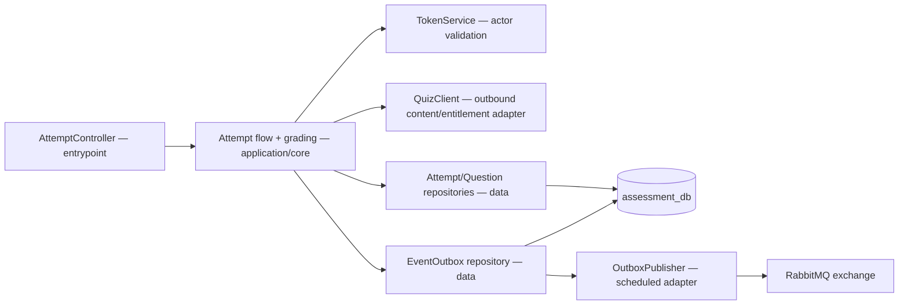
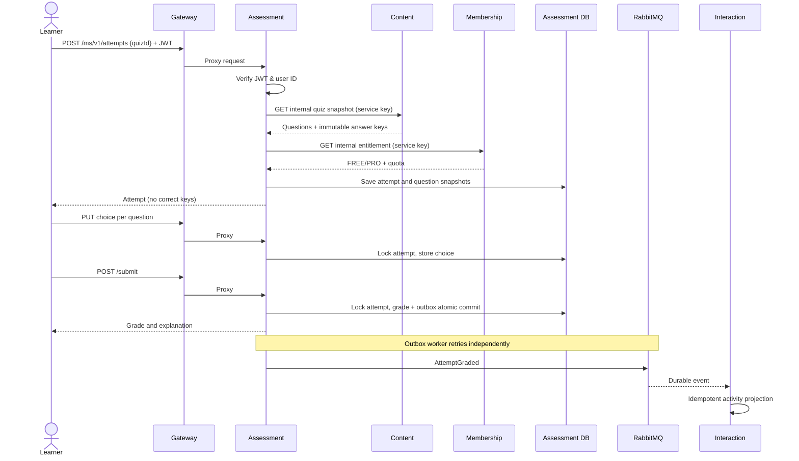
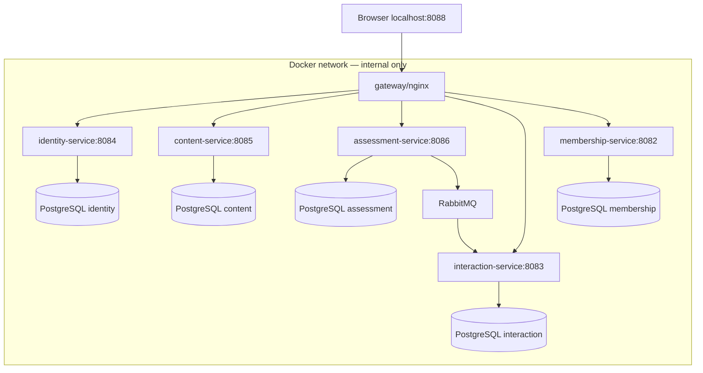

# TOEIC Learning Platform — Microservices MVP Architecture (ADD + arc42 + C4)

**Status:** Designed and coded for a five-service demo; system-wide runtime measurements **pending local execution**. **Scope:** a bounded exam demonstration, not full original TOEIC feature parity.

## 1. arc42 — Introduction and goals

**Business goal:** TOEIC learner registers, selects TOEIC content, practices, receives a grade, reviews material and accesses plans. Teacher may author quiz after authentication. Relevant stakeholders: Learner, Teacher, Admin, examiner, maintainer.

**Constraints:** KTHDV Hướng 3: IAM (JWT, roles, permissions), core domain resources, interaction, membership, 4+ deployed core services, API Gateway, database ownership, Docker Compose. KTPM: ADD, arc42, C4 L1/L2/L3, 3+ measurable scenarios, 2+ ADR, runtime & deployment view, k6 and fault injection evidence. Code should have clear `entrypoints/core/data` responsibilities; this MVP currently places some entities and controller logic in single Java classes and should be refactored into the provided boilerplate before claiming literal template conformity.

## 2. arc42 — Architecture constraints and quality goals

### Drivers (ADD)

1. **Security:** no one can access another learner's attempts; learners cannot author exam keys; JWT signature is verified inside services.
2. **Consistency:** grading is atomic/idempotent; grade and outbox are committed in one local DB transaction.
3. **Availability:** Interaction outage should not break Assessment grading; events are queued for later.
4. **Modifiability:** new content/question types can be added without direct cross-service DB access.
5. **Performance:** read-only quiz list is lightweight; use measurement rather than assumption.

### Quality Attribute Scenarios

| ID | Source / stimulus / environment | Artifact / response | Proposed acceptance / evidence |
|---|---|---|---|
| QA-01 Security | Unprivileged learner sends `POST /ms/v1/contents/quizzes` with valid learner JWT | Content rejects without writing rows | HTTP 403; query COUNT unchanged; negative smoke test |
| QA-02 Reliability | 10 concurrent submissions for one attempt under normal load | Assessment serializes parent attempt, computes one stored result, one event row | All successful retries return identical grade, DB outbox count = 1 |
| QA-03 Availability | Interaction unavailable while user submits a valid attempt | Assessment commits grade/outbox, provides score without waiting for consumer | submit HTTP 200 during failure, activity appears eventually after recovery |
| QA-04 Performance | 50 virtual users continuously request quiz list from local Docker stack for 1 minute | Gateway + Content return sanitized quiz list | target p95 under 500 ms, failed requests under 1%; k6 report |

Targets are **proposed** for TOEIC domain, not numbers stated by your two exam PDFs, and need measured results.

## 3. arc42 — Context and scope (C4 Level 1)

| External actor | Interactions |
|---|---|
| Learner | register/sign in, view quizzes, practice, feedback, membership |
| Teacher | authenticated creation of new quizzes |
| Examiner | observe demo, network failure and performance tests |

## 4. arc42 — Solution strategy

- Strategic DDD separates **Identity**, **Content**, **Assessment**, **Interaction**, **Membership** bounded contexts.
- Synchronous HTTP for immediate read results: Assessment → Content snapshot and Assessment → Membership entitlement.
- Event-driven propagation for noncritical read activity: Assessment's **transactional outbox** → RabbitMQ → Interaction activity projection.
- Immutable attempt question snapshots prevent future content edits from changing historical grades.
- PostgreSQL per service (ownership boundary); cross-DB references are bare UUIDs, never physical cross-DB foreign keys.
- Nginx as the only public API entry point, with internal routes blocked. Internal auth uses service key; external auth uses signed JWT.

## 5. arc42 — Building block view (C4 Level 2)

### C4 Level 3 — Assessment components

**Repository vs ideal layering:** Controllers, entities and application logic are intentionally compact in this demo. To fully match the provided `entrypoints/core/data` boilerplate, split them into packages before final submission. This gap is tracked rather than hidden.

## 6. arc42 — Runtime view

### Scenario: Start, answer and submit practice

**Failure narrative:** If Interaction is down, RabbitMQ persists the event queue. If RabbitMQ is down, the row remains pending in Assessment outbox until publisher recovers. Limitations: publisher confirmation still needs hardening.

## 7. arc42 — Deployment view (Docker Compose)

## 8. arc42 — Crosscutting concepts

- **Security:** BCrypt for identity password storage; role/permission claims; Signature HMAC-SHA256 and exp, iss, aud verification; UUID actor always sourced from token. Internal service key not exposed through Gateway.
- **Data integrity:** pessimistic lock on attempt for save/submit; idempotent submit; immutable snapshots; outbox saved inside grading transaction. No distributed transaction across Content/Membership and Assessment, because snapshot and entitlement are read before local commit. A membership changing concurrently can produce an entitlement race—acceptable for this educational MVP, not a billing guarantee.
- **Observability:** `docker compose logs`, RabbitMQ dashboard, health by endpoint; structured traces not implemented.
- **Data and privacy:** each database belongs to a single service; review GET currently returns user UUID (redact for real product).
- **API resilience:** direct synchronous service calls with timeouts; circuit breaker/retry are suggested production extensions, not implemented.

## 9. arc42 — Architectural decisions

See `ADR_MVP.md` for ADR-001 to ADR-005; major tradeoffs: five service boundaries vs simplicity, JWT vs opaque session, RabbitMQ outbox vs direct HTTP, relational database ownership and testable UI.

## 10. arc42 — Quality requirements

QA-01 to QA-04 above; for verification use `tests/smoke.py`, `tests/load.js`, `tests/fault_injection.md`. Record results in `REPORT_TEMPLATE.md`.

## 11. arc42 — Risks & technical debt

1. **Not full production TOEIC migration**: original React web/mobile, RAG, SRS and exam bank not ported.
2. **Symmetric signing key shared with all services**: change to RS256/EdDSA JWKS and key rotation.
3. **No instant token revocation**: short-lived 30min token; implement central revocation/version check if required.
4. **Demo-only membership plan upgrade**: users can self-activate PRO when flag is true; never accept as paid entitlement.
5. **Outbox publisher confirmations not implemented**: broker accepted/ack not tracked; use confirms and retry-safe transitions.
6. **Full `entrypoints/core/data` boilerplate mapping not yet implemented**.
7. **No live validation here**: check Docker builds, migrations and test outputs locally.

## 12. arc42 — Glossary

| Term | Definition |
|---|---|
| Bounded Context | Autonomous ownership of a business model |
| Aggregate | Consistency boundary inside one domain |
| Assessment snapshot | Immutable content copied into attempt at its creation |
| Outbox | Local table atomically recording events before async publish |
| Entitlement | Membership right that gates access to premium quiz |
| API Gateway | Public ingress that routes requests to independent services |
