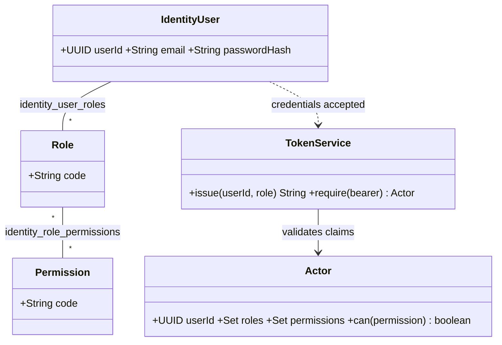
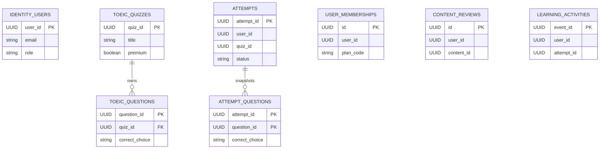

# Báo cáo KTHDV & KTPM — Bảng bằng chứng thực nghiệm

**Không tự điền số liệu nếu chưa chạy.** Các tiêu chí là mục tiêu thiết kế, chưa phải kết quả được đo.

## I. KTHDV — Hướng 3

| Tiêu chí | Bằng chứng cần chụp | Kết quả |
|---|---|---|
| 5 independent Core Microservices | `docker compose ps`, image/service logs | [CHƯA CHẠY] |
| Independent Gateway | network tab: UI → :8088, nginx routes | [CHƯA CHẠY] |
| 5 databases | `docker compose exec <db> psql ... \l` | [CHƯA CHẠY] |
| JWT roles/permissions | login response (redact JWT), decoding header/payload, denied learner authoring | [CHƯA CHẠY] |
| Interaction records reviews + activity | UI screenshot and `interaction_db` rows | [CHƯA CHẠY] |
| Membership FREE vs PRO | free 403 for premium, demo PRO allows it | [CHƯA CHẠY] |
| No cross-database FK | ERD and migrations in each service | [ĐÃ THIẾT KẾ] |
| Docker Compose | `docker compose config` & full stack boot | [CHƯA CHẠY] |

### Class diagram for RBAC

### ERD ownership (abbreviated)

`user_id`, `content_id`, `quiz_id` in other databases are IDs **without cross-database foreign keys**.

## II. KTPM — ADD / arc42 / C4

- arc42 1/3/4/5/6/7/9/10 sections: see `EXAM_ARCHITECTURE.md`.
- At least 3 Quality Attribute Scenarios: QA-01, QA-02, QA-03, QA-04.
- ADRs: see `ADR_MVP.md` (five).
- C4 L1, L2, L3 and Runtime/Deployment Mermaid diagrams in architecture file.

### Experiment results (fill after actual tests)

| Experiment | Command | Expected | Observed | Screenshot |
|---|---|---|---|---|
| Functional smoke | `python tests/smoke.py` | all assertions pass | [PENDING] | [PENDING] |
| Performance 50 VUs / 1m | `k6 run tests/load.js` | p95 < 500ms, errors <1% | [PENDING] | [PENDING] |
| Interaction down | stop service then submit | grade success, event later visible | [PENDING] | [PENDING] |
| RabbitMQ down | stop broker then submit | grade success, outbox pending | [PENDING] | [PENDING] |
| No cross-user read | use another learner token | 404 / denied | [PENDING] | [PENDING] |
| Concurrent submit | 10 submits concurrently | same score, one outbox row | [PENDING] | [PENDING] |

### Suggested screenshot set

1. Login / learner homepage / quiz list
2. Exam in progress (no answer key) / graded result (explanations)
3. FREE denied for PRO quiz / PRO demo activation
4. Content/Identity/Assessment/Interaction/Membership logs and `docker compose ps`
5. RabbitMQ management queue + activity received after Interaction restart
6. k6 summary with requests, p95 and failures

### Final conclusion template

> Trong môi trường [MÁY], ngày [NGÀY], hệ thống chạy [SỐ] container. Kịch bản QA-01 ... [SỐ LIỆU]. Những kịch bản chưa đạt: ... Phân tích nguyên nhân: ... Biện pháp cải tiến: ...

## III. Limitations to disclose in report

This bundle is an integrated **TOEIC MVP**; it does not migrate all original source features. The original project is a Spring Boot modular monolith with mature question bank, assessment, SRS and RAG. The demo's compact service code has not yet been reorganized to a literal `entrypoints/core/data` boilerplate. Any requirement for full original feature parity or strict provided boilerplate remains future work. Execution evidence must be captured on a machine capable of Docker+Maven dependency resolution.
